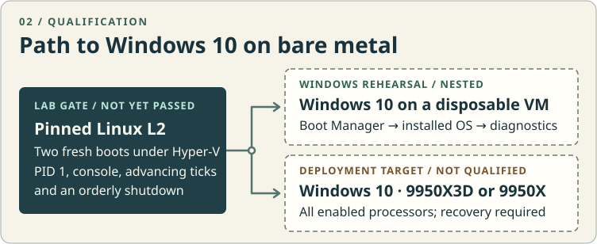

# AMD SVM hypervisor lab

An x86-64 lab for **AMD Secure Virtual Machine (SVM) and Nested Page Tables (NPT)**. The goal is a type-1 hypervisor that boots directly from removable media and runs a single-vCPU Linux guest. Today, Windows Hyper-V on a **Ryzen 9 9950X** hosts the experiment. The guests that passed are short, fixed instruction sequences, not ordinary operating systems.

| Evidence | Result and limit |
|---|---|
| **`main` firmware through [041][runtime]** | A standalone L1 took control after UEFI boot services ended, ran fixed L2 guests, and checked their registers, memory and exits. |
| **Feature branches through host trial [100][pm1]** | Some earlier [feature trials][features] ran fixed guests. Recent host-only trials checked device behavior: [099][com] distinguished COM1 from three absent ports; [100][pm1] covers ACPI PM1a byte access. Neither booted a guest or advanced `main` firmware. |
| **Not qualified** | No ordinary Linux or Windows guest boot; no physical boot from removable media. The physical targets are **9950X first, then 9950X3D**; each requires separate qualification. There is no five-year AMD compatibility promise; Intel VMX/EPT is out of scope. |

## What the nested lab proves


[Trial 039][protect] checks the forbidden store **and** the byte it must not change. [Trial 040][remap] asks a different question: can the same guest address read from a new backing frame after a translation flush? A halt or a screenshot without the expected values would not answer either question.

## Capability map

The middle column is [integrated, nested evidence][ledger]. In the right column **Nested** means a controlled VM trial on a feature revision; **Host** means a model or offline inspection with no guest execution. Follow the links for the exact fixture and its limits.

| Subsystem | `main` · nested fixtures | Additional evidence, by scope |
|---|---|---|
| Boot & loader | [UEFI handoff, private stack and bounded allocator][handoff]; [first L2 entry][entry] | **Nested:** [staged input identity][inputs], [pre-entry CR3 and RSI checks][guard]. **Host:** [EFI media readback][media]. |
| CPU & exits | [CPUID reply and resume][cpuid]; [unsupported-leaf stop][runtime]; [invalid-opcode delivery and return][ud] | **Nested:** [refused CR4 write raises #GP][gp]; [fixed EFER read][efer]. |
| Register state | [Integer registers, XMM0–15 and x87 stack/control][runtime]; [MXCSR rounding and status][mxcsr] | These are legacy FP/SSE checks, not AVX/XSAVE or vCPU migration. |
| Address translation | [Write revocation][protect]; [frame remap][remap]; [private-page boundary][runtime]; [two-processor local flushes][cross]; [Hyper-V GPA flush][flush] | **Nested:** [page-fault attribution][faults], [owned page from writable to executable][seal], [fetch-fault address][fetch]. **Host:** [four-level NPT layout][layout]. |
| Interrupts & time | [Wake after HLT][wake]; [defer past STI][sti]; [priority masking][priority] | **Nested:** [one-shot PIT IRQ0][pit]. **Host:** [dual PIC setup][pic], [virtual-clock calibration][calibration], [IRQ9 controller acceptance][sci] (not CPU delivery). |
| Console & power | [Fixed guest serial transmit][runtime] | **Nested:** [polled 8250 output][uart], [UART IRQ4][irq4], [virtual ACPI S5 request][s5]. **Host:** [COM1 presence/absent ports][com], [PM1a status and enable bytes][pm1]. |

**Open loader questions:** [#90](https://github.com/kuro1337WStuff/hv/issues/90) asks which bytes and sections share the kernel entry page; it does not grant execute permission. [#91](https://github.com/kuro1337WStuff/hv/issues/91) asks whether the pinned initramfs contains the interpreter chain for `/init`; finding the files is not evidence that PID 1 ran.

## Qualification roadmap



1. **First, pinned Linux under Hyper-V.** Require a serial console, an initramfs PID 1 marker, advancing ticks across a declared uptime interval, and an orderly shutdown on **two fresh boots** of the same pinned inputs. Record both runs. Review the firmware, storage, timer and interrupt paths the next guest would need; a passing host model alone does not open the gate.
2. **Optional Windows 10 trial, VM first.** Only after that Linux evidence and capability review, an operator may try a **licensed, disposable, offline Windows 10 L2** under the lab hypervisor, inside Hyper-V. Use a disposable virtual disk and take an outer VM checkpoint before each stage. First collect installer evidence; only then attempt installed-guest boot, uptime, console and shutdown, and repeat from a known checkpoint. Set a time limit and stop condition before each attempt. On timeout, crash or unexpected output, stop, retain the logs and restore the checkpoint; do not advance. This is not a crash-free or compatibility guarantee.
3. **Separate physical decision.** Stable, repeated nested evidence is a prerequisite, not permission to deploy. An operator would need independent recovery media, a verified recovery procedure and **no primary disk attached** before considering removable media on a 9950X, then a separate qualification on a 9950X3D. A Windows VM result would not qualify either machine.

**Correctness before speed.** The [feature report](journal/reports/feature-phase.svg) is a view of the [retained journal data](journal/reports/feature-phase.json); [trial 101](journal/trials/101.md) records its scope. The [journal renderer](lab/measurement/journal_dashboard.py) is reusable. A future timing comparison needs independent runs with the same workload, unit and environment, identified sources, and a correctness check on both sides. No benchmark or deployment is part of this report.

[ledger]: journal/test-report.md
[features]: journal/status.md#feature-evidence-before-the-separate-trial-ledger
[handoff]: journal/test-report.md#036--2026-11-25-local--standalone-l1-handoff
[entry]: journal/test-report.md#037--2026-11-25-local--one-l2-entry-from-the-standalone-l1
[cpuid]: journal/test-report.md#038--2026-11-25-local--standalone-l1-cpuid-resume
[runtime]: journal/test-report.md#041--2026-11-25--standalone-runtime-package-and-two-processor-control
[mxcsr]: journal/test-report.md#030--2026-11-25-local--mxcsr-rounding-and-status-preservation
[layout]: journal/test-report.md#004006--2026-11-24--fixed-npt-layout
[protect]: journal/test-report.md#039--2026-11-25-local--standalone-l1-npt-write-protection
[remap]: journal/test-report.md#040--2026-11-25-local--standalone-backing-frame-remap-and-baseline-batch
[cross]: journal/test-report.md#015--2026-11-24-local--two-measured-l1-processor-ids-and-shared-npt-remap
[flush]: journal/test-report.md#017--2026-11-24-local--one-all-processor-nested-gpa-flush
[wake]: journal/test-report.md#022--2026-11-24-local--one-virtual-interrupt-wakes-l2
[sti]: journal/test-report.md#025--2026-11-24-local--pending-vector-delivered-after-the-sti-shadow
[priority]: journal/test-report.md#026--2026-11-24-local--virtual-interrupt-priority-threshold
[ud]: journal/test-report.md#027--2026-11-24-local--invalid-opcode-delivery-and-return
[inputs]: https://github.com/kuro1337WStuff/hv/blob/c50789a0dbe11690abed52f00a92d900775f7021/journal/test-report.md#045--staged-linux-input-identity-before-guest-entry
[guard]: https://github.com/kuro1337WStuff/hv/blob/c50789a0dbe11690abed52f00a92d900775f7021/journal/test-report.md#051--pre-entry-state-guard-for-the-pinned-nx-fetch
[faults]: https://github.com/kuro1337WStuff/hv/blob/c50789a0dbe11690abed52f00a92d900775f7021/journal/test-report.md#053--paired-guest-and-nested-page-faults
[seal]: https://github.com/kuro1337WStuff/hv/blob/429a6814bfbe4f0ad21acba345b5a2bdd7e62865/journal/runs/060-l1-page-transition.md
[fetch]: https://github.com/kuro1337WStuff/hv/blob/c50789a0dbe11690abed52f00a92d900775f7021/journal/test-report.md#044--2026-11-25--controlled-nested-fetch-address-precision
[gp]: https://github.com/kuro1337WStuff/hv/blob/c50789a0dbe11690abed52f00a92d900775f7021/journal/test-report.md#056--deliver-a-general-protection-fault-after-a-refused-cr4-write
[uart]: https://github.com/kuro1337WStuff/hv/blob/c50789a0dbe11690abed52f00a92d900775f7021/journal/test-report.md#047--polled-8250-compatible-serial-output
[irq4]: https://github.com/kuro1337WStuff/hv/blob/0b7c28a4cb7f39d0e09073415dfcf2efa823a47b/journal/runs/062-l1-uart-irq4.md
[pit]: https://github.com/kuro1337WStuff/hv/blob/c50789a0dbe11690abed52f00a92d900775f7021/journal/test-report.md#048--pit-one-shot-legacy-irq0-and-a-specific-eoi
[pic]: journal/trials/082.md
[s5]: https://github.com/kuro1337WStuff/hv/blob/c50789a0dbe11690abed52f00a92d900775f7021/journal/test-report.md#050--virtual-s5-request-versus-guest-text-and-hlt
[media]: journal/trials/078.md
[efer]: https://github.com/kuro1337WStuff/hv/blob/0fe588858882b35f0df82ad0a2700f0550b4e5a8/journal/runs/064-l1-efer-read.md
[calibration]: journal/trials/097.md
[sci]: journal/trials/098.md
[com]: journal/trials/099.md
[pm1]: journal/trials/100.md

## Quickstart: stage one fixed guest

From a fresh Windows checkout, use Git, Python 3.11+, Windows PowerShell 5.1, and Visual Studio Build Tools with the MSVC x64 C/C++ tools and assembler. The first build needs internet access for EDK II headers and the Python ISO-packaging dependencies. From the repository root:

```powershell
python lab/hv_queue.py run --stage-only --rebuild cpuid
```

This builds `build/hv-cpuid-resume.iso` and stages a digest-named copy. **Stop here for a build-only check:** do not execute the printed worker command. No VM starts; staging is not a guest pass. `cpuid` is the small UEFI-hosted profile, distinct from the post-handoff `l1-cpuid` fixture.

<details>
<summary>Optional: run the fixed guest in your own isolated Hyper-V lab</summary>

- **Host:** AMD SVM enabled in firmware, Hyper-V and its PowerShell module. [Microsoft's AMD nesting prerequisites](https://learn.microsoft.com/en-us/windows-server/virtualization/hyper-v/enable-nested-virtualization#prerequisites) specify **Windows 11 or later, or Windows Server 2022 or later**, and VM configuration version **9.3+**. Windows 10 above is a proposed **L2 guest**, not the Hyper-V host. Microsoft [does not support third-party hypervisors nested under Hyper-V](https://learn.microsoft.com/en-us/windows-server/virtualization/hyper-v/nested-virtualization#non-microsoft-virtualization-on-hyper-v-virtualization); this is a lab result, not a support claim.
- **Isolation:** Use a fresh, dedicated lab on a host you control. Never reuse the project's held VMs. If `HV-SVM-L1` or its store already exists, leave it untouched and use a separate lab host.
- **VM:** Create a Generation 2 VM named `HV-SVM-L1` under `lab/machines/HV-SVM-L1/` in the checkout. Use two vCPUs with virtualization extensions exposed, 2 GiB static RAM, no network adapter, standard checkpoints and exactly one DVD drive first in boot order. Disable Secure Boot **in the VM only**. Leave the VM **off with an empty DVD drive**. The [provisioner](lab/New-HvLab.ps1) illustrates these settings; do not run it for this quickstart, as it requires and boots a separate Alpine ISO.

After staging, from the same checkout:

```powershell
python lab/hv_queue.py run cpuid
```

The launcher requests elevation for the visible VM worker, which checkpoints the VM before boot. `PASS` means the captured guest console matched the reviewed success screen; `COMPLETE` means the batch finished. `ATTENTION` stops the queue for inspection; it is **not** a guest pass. Use the printed run ID to find events and console capture in `build/runs/<run-id>/`. Press **Q** in the worker window to request a stop. A stop does not automatically rewind a checkpoint.

</details>

## Where to go next

- [Lab guide](lab/README.md) — profile commands, stop controls, and result handling.
- [Development journal](journal/README.md) — milestones and reviewed console screenshots.
- [Test ledger](journal/test-report.md) — commands, measured values, failed attempts, and limits of each result.
- [Current status](journal/status.md) — integrated baseline, feature trials, open issues and next decisions.
- [Project workflow](journal/project-workflow.md) — repository map and how trial evidence reaches `main`.
