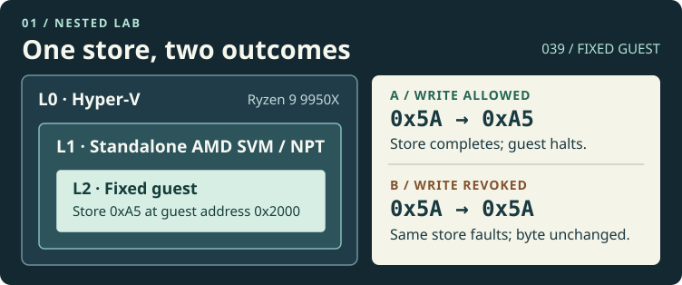

# AMD SVM hypervisor lab

This lab builds a small x86-64 hypervisor using AMD Secure Virtual Machine (SVM) and Nested Page Tables (NPT). Its fixed guests make each claim testable: the same store must succeed on a writable page and fault on a read-only page **without changing the backing byte**.

**Tested:** nested virtualization on Windows Hyper-V with a Ryzen 9 9950X. **Target, not tested:** a removable-media hypervisor running a single-vCPU Linux guest on a physical Ryzen 9 9950X3D. No ordinary Linux boot or bare-metal qualification is claimed. These images are not replacements for a host bootloader.



## Capability roadmap

**M** = tested on [`main`][ledger] · **F** = tested on a [feature branch][features] · **H** = host check only · **T** = target, not demonstrated. VM results are from fixed guests under Hyper-V, not bare metal.

| Boot, CPU & memory | Interrupts, devices & qualification |
|---|---|
| M · [UEFI boot-services handoff][handoff] | M · [Interrupt wakes a halted guest][wake] |
| M · [Bootstrap allocator survives OOM][handoff] | M · [IRQ deferred past STI shadow][sti] |
| M · [Standalone L1 launches L2][entry] | M · [Virtual IRQ priority masking][priority] |
| M · [CPUID emulation and resume][cpuid] | M · [Invalid-opcode delivery and return][ud] |
| M · [Unsupported CPUID stops the guest][runtime] | F · [Refused CR4 write raises #GP][gp] |
| M · [64-bit GPR preservation][runtime] | M · [Fixed guest serial transmit][runtime] |
| M · [XMM0–15 preservation][runtime] | F · [Polled 8250 serial output][uart] |
| M · [x87 stack and control restore][runtime] | F · [UART transmit interrupt (IRQ4)][irq4] |
| M · [MXCSR rounding and status restore][mxcsr] | F · [One-shot PIT interrupt (IRQ0)][pit] |
| H · [Four-level NPT layout check][layout] | H · [Dual 8259A PIC initialization][pic] |
| M · [NPT write-permission revocation][protect] | F · [Virtual ACPI S5 power-off request][s5] |
| M · [Backing-frame remap at fixed GPA][remap] | H · [EFI image readback from boot media][media] |
| M · [Private-page boundary enforcement][runtime] | M · [Fixed-work guest exit counts][runtime] |
| M · [Two-vCPU remap with local flushes][cross] | T · Pinned Linux kernel boot |
| M · [Hyper-V guest-physical space flush][flush] | T · Linux serial console handover |
| F · [Staged Linux input identity check][inputs] | T · Initramfs reaches PID 1 |
| F · [Pre-entry CR3 and RSI checks][guard] | T · Linux timer tick progress |
| F · [Guest vs. nested page-fault attribution][faults] | T · Repeatable cold boots |
| F · [Owned page: writable to executable][seal] | T · Per-exit latency measurement |
| F · [Nested instruction-fetch fault address][fetch] | T · Same-work native timing baseline |

Physical qualification targets: Ryzen 9 **9950X** first, then **9950X3D**. Other AMD CPUs from the last five years need per-model SVM/NPT checks; none are claimed qualified here. Intel VMX/EPT is out of scope.

[ledger]: journal/test-report.md
[features]: journal/status.md#feature-evidence-before-the-separate-trial-ledger
[handoff]: journal/test-report.md#036--2026-11-25-local--standalone-l1-handoff
[entry]: journal/test-report.md#037--2026-11-25-local--one-l2-entry-from-the-standalone-l1
[cpuid]: journal/test-report.md#038--2026-11-25-local--standalone-l1-cpuid-resume
[runtime]: journal/test-report.md#041--2026-11-25--standalone-runtime-package-and-two-processor-control
[mxcsr]: journal/test-report.md#030--2026-11-25-local--mxcsr-rounding-and-status-preservation
[layout]: journal/test-report.md#004006--2026-11-24--fixed-npt-layout
[protect]: journal/test-report.md#039--2026-11-25-local--standalone-l1-npt-write-protection
[remap]: journal/test-report.md#040--2026-11-25-local--standalone-backing-frame-remap-and-baseline-batch
[cross]: journal/test-report.md#015--2026-11-24-local--two-measured-l1-processor-ids-and-shared-npt-remap
[flush]: journal/test-report.md#017--2026-11-24-local--one-all-processor-nested-gpa-flush
[wake]: journal/test-report.md#022--2026-11-24-local--one-virtual-interrupt-wakes-l2
[sti]: journal/test-report.md#025--2026-11-24-local--pending-vector-delivered-after-the-sti-shadow
[priority]: journal/test-report.md#026--2026-11-24-local--virtual-interrupt-priority-threshold
[ud]: journal/test-report.md#027--2026-11-24-local--invalid-opcode-delivery-and-return
[inputs]: https://github.com/kuro1337WStuff/hv/blob/c50789a0dbe11690abed52f00a92d900775f7021/journal/test-report.md#045--staged-linux-input-identity-before-guest-entry
[guard]: https://github.com/kuro1337WStuff/hv/blob/c50789a0dbe11690abed52f00a92d900775f7021/journal/test-report.md#051--pre-entry-state-guard-for-the-pinned-nx-fetch
[faults]: https://github.com/kuro1337WStuff/hv/blob/c50789a0dbe11690abed52f00a92d900775f7021/journal/test-report.md#053--paired-guest-and-nested-page-faults
[seal]: https://github.com/kuro1337WStuff/hv/blob/429a6814bfbe4f0ad21acba345b5a2bdd7e62865/journal/runs/060-l1-page-transition.md
[fetch]: https://github.com/kuro1337WStuff/hv/blob/c50789a0dbe11690abed52f00a92d900775f7021/journal/test-report.md#044--2026-11-25--controlled-nested-fetch-address-precision
[gp]: https://github.com/kuro1337WStuff/hv/blob/c50789a0dbe11690abed52f00a92d900775f7021/journal/test-report.md#056--deliver-a-general-protection-fault-after-a-refused-cr4-write
[uart]: https://github.com/kuro1337WStuff/hv/blob/c50789a0dbe11690abed52f00a92d900775f7021/journal/test-report.md#047--polled-8250-compatible-serial-output
[irq4]: https://github.com/kuro1337WStuff/hv/blob/0b7c28a4cb7f39d0e09073415dfcf2efa823a47b/journal/runs/062-l1-uart-irq4.md
[pit]: https://github.com/kuro1337WStuff/hv/blob/c50789a0dbe11690abed52f00a92d900775f7021/journal/test-report.md#048--pit-one-shot-legacy-irq0-and-a-specific-eoi
[pic]: journal/trials/082.md
[s5]: https://github.com/kuro1337WStuff/hv/blob/c50789a0dbe11690abed52f00a92d900775f7021/journal/test-report.md#050--virtual-s5-request-versus-guest-text-and-hlt
[media]: journal/trials/078.md

## Build and run one guest

Start with `cpuid`: after L1 handles the exit, L2 checks the reply registers and reaches its success halt. This is the small UEFI-hosted profile, not the post-handoff `l1-cpuid` test.

- **Host:** Windows with Hyper-V and its PowerShell module, AMD SVM enabled in firmware, and support for AMD nested virtualization (VM configuration version 9.3 or newer).
- **Build tools:** Git, Python 3.11+, Windows PowerShell 5.1, and Visual Studio Build Tools with the MSVC x64 C/C++ tools and assembler. The first build needs internet access for EDK II headers and the Python ISO-packaging dependencies.
- **Isolation:** Use a fresh checkout and a fresh, dedicated lab on a host you control. **Never reuse the project's held VMs.** If `HV-SVM-L1` or its store already exists, leave it untouched; use a separate lab host rather than repointing the runner.
- **VM:** In that lab, create a Generation 2 VM named `HV-SVM-L1`, stored under `lab/machines/HV-SVM-L1/` in the checkout. Set two vCPUs with virtualization extensions exposed, 2 GiB static RAM, no network adapter, standard checkpoints, and exactly one DVD drive first in boot order. Disable Secure Boot **in the VM only**. Leave the new VM **off with an empty DVD drive**. The [provisioning script](lab/New-HvLab.ps1) illustrates the settings; do not run it for this quickstart, as it requires and boots a separate Alpine ISO.

From the repository root in PowerShell:

```powershell
python lab/hv_queue.py run --rebuild cpuid
```

The launcher builds `build/hv-cpuid-resume.iso`, stages a digest-named copy, and requests elevation for the VM worker. The worker checkpoints the VM before boot. `PASS` means the captured guest console matched the reviewed success screen; `COMPLETE` means the batch finished. `ATTENTION` means the queue stopped for inspection, **not** that the guest passed. Find the events and console capture in `build/runs/<run-id>/` using the printed run ID. Press **Q** in the worker window to request a stop.

## Where to go next

- [Lab guide](lab/README.md) — profile commands, stop controls, and result handling.
- [Development journal](journal/README.md) — milestones and reviewed console screenshots.
- [Test ledger](journal/test-report.md) — commands, measured values, failed attempts, and limits of each result.
- [Current status](journal/status.md) — integrated baseline, feature trials, open issues and next decisions.
- [Project workflow](journal/project-workflow.md) — repository map and how trial evidence reaches `main`.
