# Hypervisor development journal

Development host: Ryzen 9 9950X. Firmware runs use the `HV-SVM-L1` Hyper-V VM; host-only checks are labeled separately. Neither qualifies the 9950X3D deployment target on bare metal.

## 050 · 2026-11-25 · Shutdown is a port write, not a message

Two guests printed the same `L2:S5` line. The first halted and remained waiting; the second set SLP_EN on virtual PM1a, and L1 stopped at that OUT without re-entering. Neither arm touched host power. [Build, counts and evidence](test-report.md#050--virtual-s5-request-versus-guest-text-and-hlt).

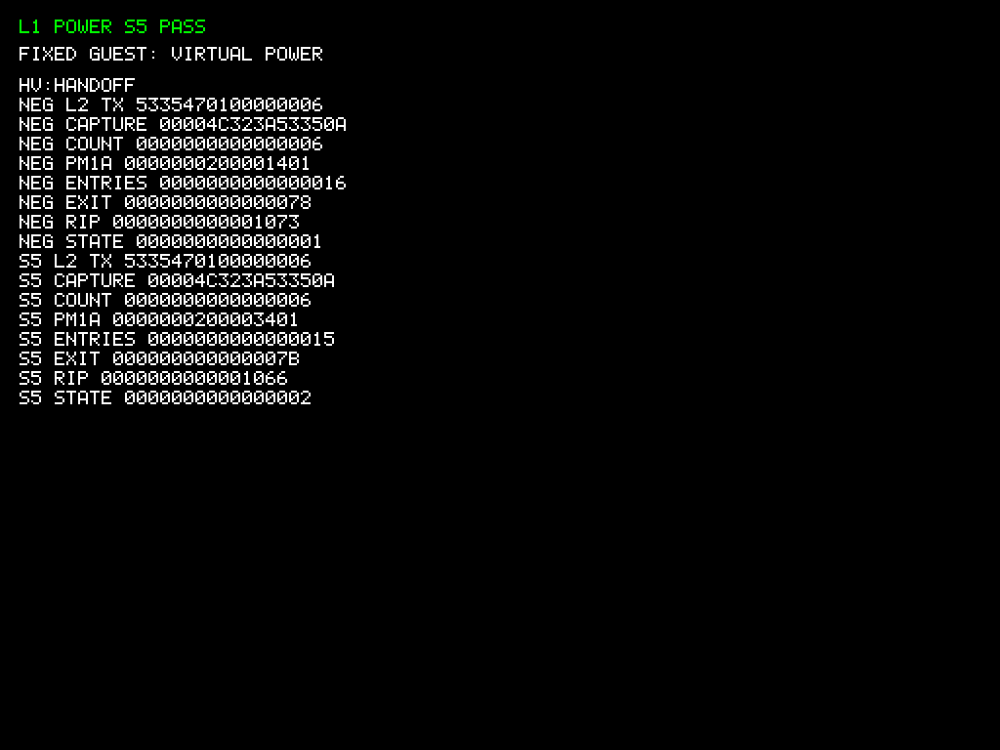

## 049 · 2026-11-25 · Bounded guest console capture

Both polled transmit phases reached the receiver byte-for-byte. With capacity reduced to 24, L1 stopped on the next OUT rather than silently truncating or inventing a guest completion marker. Not a Linux tty handover. [Transcript and independent exit](test-report.md#049--two-phase-console-and-bounded-capture).

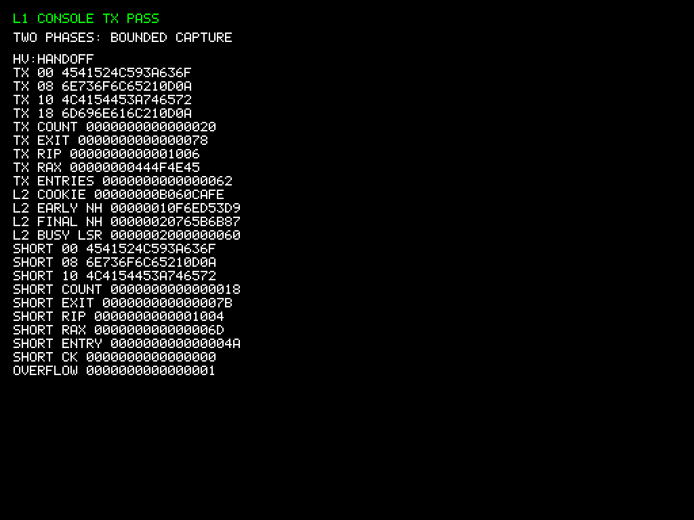

## 048 · 2026-11-25 · A pending IRQ and a later HLT wake

The first virtual PIT expiry stayed pending while IRQ0 was masked. The second woke a halted guest at its programmed tick, not one tick earlier. L2 recorded both return addresses, and L1 observed two specific EOIs. No Linux calibration or native latency is inferred. [Deadlines and exit accounting](test-report.md#048--pit-one-shot-legacy-irq0-and-a-specific-eoi).

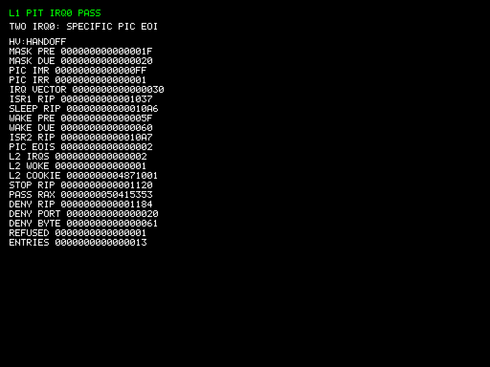

## 047 · 2026-11-25 · Serial bytes from the guest, not the monitor

**Passed in `HV-SVM-L1`.** The fixed L2 initialized virtual COM1 for 8N1, selected divisor 1, and polled until its last byte drained. L1 captured exactly `L2:8250` followed by LF. Both sides counted eight busy polls, and L2 reached its success halt. Programming the divisor did not accidentally transmit a byte.

A separate L2 write of `0xA5` to COM2 stopped at the `OUT` instruction. It was neither forwarded nor appended to the capture. This proves the polled transmit path, not a Linux console boot or interrupt-driven serial. [Commands and measured fields](test-report.md#047--polled-8250-compatible-serial-output).

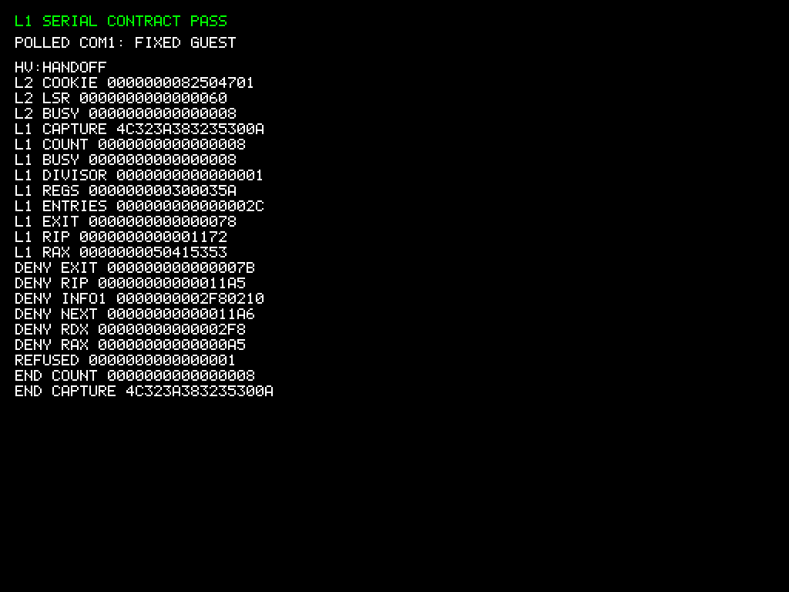

## 046 · 2026-11-25 · What the fixed guest sees across a CPU exit

**Passed in `HV-SVM-L1`.** L2 saw one explicitly virtual CPU with SSE2 advertised and AVX/XSAVE absent from its feature bits. It put 21 in XMM0, took a CPUID exit, then doubled the preserved value to 42 after resume. L1 independently checked its own register state after all five exits.

The fifth exit was the deliberate unsupported MSR read. L1 stopped at the guest's `RDMSR` instruction, without forwarding it or resuming L2. This was a fixed guest on the 9950X development VM, not Linux or a bare-metal qualification. [Run command, expected contract and observed fields](test-report.md#046--single-vcpu-contract-and-terminal-msr-refusal).

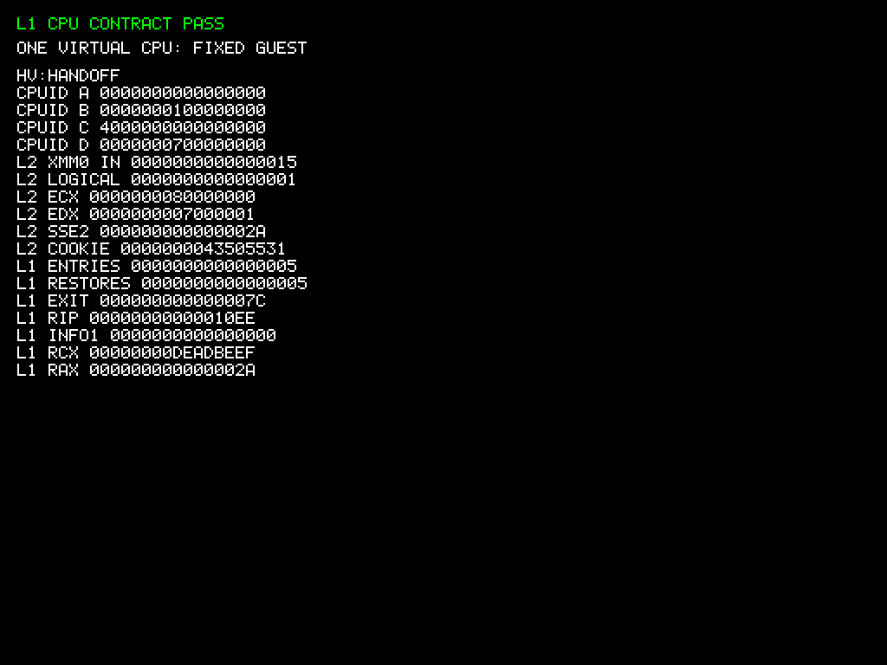

## 045 · 2026-11-25 · Staged input verification before VMRUN

**Passed in the nested VM.** Changing one bit of the kernel, initramfs, or command line in L1's private staging memory caused L1 to identify that specific input and reject it with **zero guest entries**. File lengths and the mounted ISO did not change.

Restoring the original bytes made the same check accept them. The instruction-site counter then recorded four `VMRUN` attempts: three non-executable control fetches and one denied Linux entry fetch. Linux did not boot.

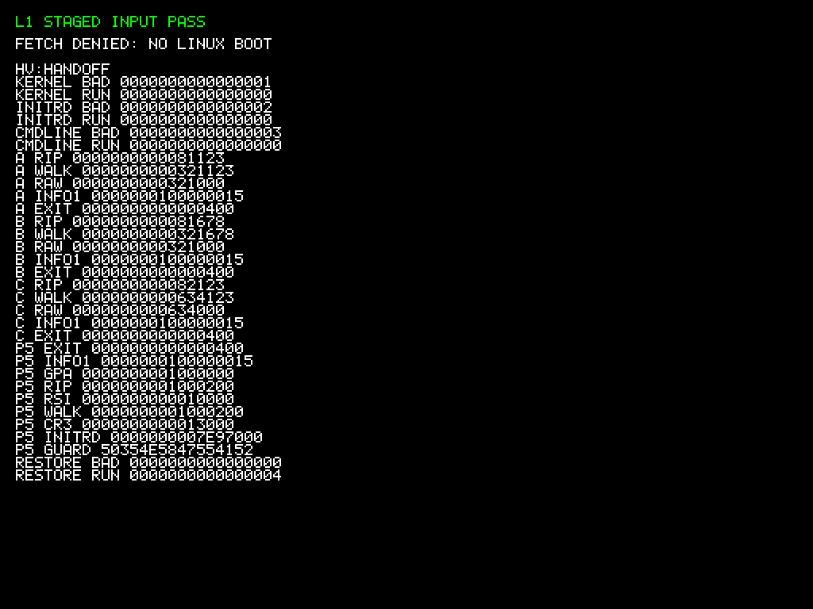

The [test ledger](test-report.md#045--staged-linux-input-identity-before-guest-entry) records the hashes, mutation sites, host checks, and first-capture queue outcome.

## 044 · 2026-11-25 · Why the Linux entry fetch reported a page base

**Admission passed with Linux execution still denied.** Two different byte offsets in one guest physical page returned the same raw fault address. Changing the mapped page changed that address. Saved RIP stayed exact throughout. The Linux entry then followed the same rule: RIP and the independent walk gave `0x1000200`, while `EXITINFO2` gave `0x1000000`. Run 043 correctly failed its exact-byte assertion; run 044 separates fault cause, instruction position and fault-address precision.

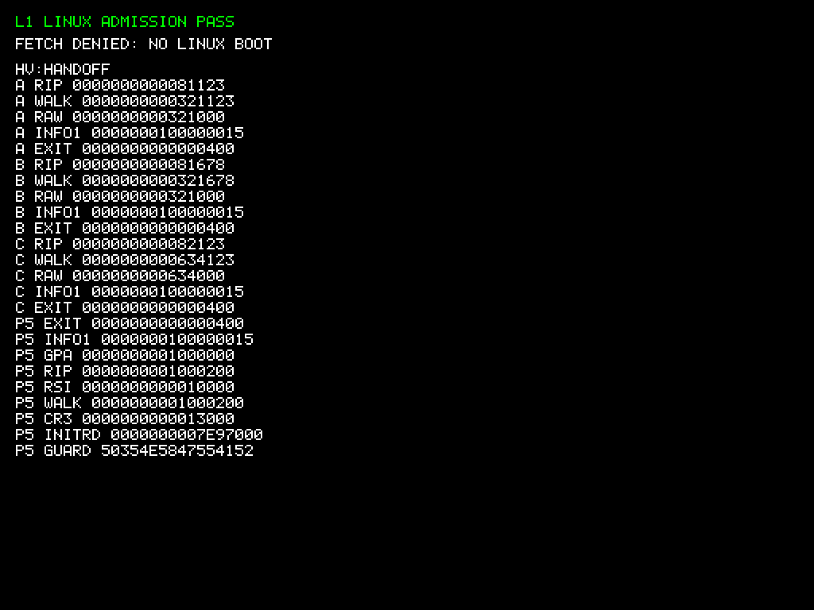

The [ledger](test-report.md#044--2026-11-25--controlled-nested-fetch-address-precision) records the command, raw values, source and image hashes. The next boundary is verifying staged inputs before any executable Linux profile; this capture is not a Linux boot.

## 042–043 · 2026-11-25 · Linux layout verified; first-fetch admission stopped

The pinned Alpine kernel, initramfs and command line produced the same hashes in two offline preparations. The host verifier checked their placement, the reserved hole, guest page tables and boot parameters. In the nested VM, L1 then staged those inputs and attempted one kernel-entry fetch while keeping guest RAM non-executable.

**043 failed.** SVM reported a final instruction-fetch protection fault, and saved RIP matched the entry `0x1000200`. The reported fault GPA was `0x1000000` instead of the expected `0x1000200`. These are the same 4 KiB page, **not the same address**. The private guard remained intact. The test did not resume or enable execution; there was no Linux userspace result. The [ledger](test-report.md#043--2026-11-25--linux-first-fetch-admission-failed) records the original oracle, raw fields, checkpoint, and next diagnostic.

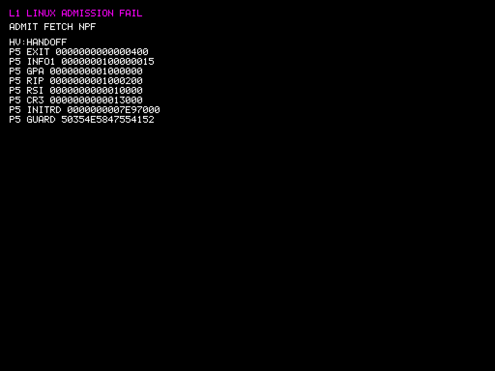

## 041 · 2026-11-25 · State, bounded exits, and timer wake after firmware handoff

**Passed on the nested 9950X.** After a `VMMCALL`, the resumed guest used its changed rounding state to calculate 1 (SSE) and 12 (x87); L1 independently checked its registers at both exits. Rejecting an unsupported CPUID request took exactly one entry and left RIP on the instruction. In a fresh guest, L1 reinjected `#UD` at the faulting `UD2`, and the guest handler ran once and returned past it.

The last byte of guest data was writable; the first byte beyond it faulted and left L1's guard intact. In the interrupt fixture, three delivered requests produced three acknowledgements, including one after the guest halted and its virtual timer expired. L2 transmitted `L2:UART:TX` one byte at a time, then halted at a different site with a success marker.

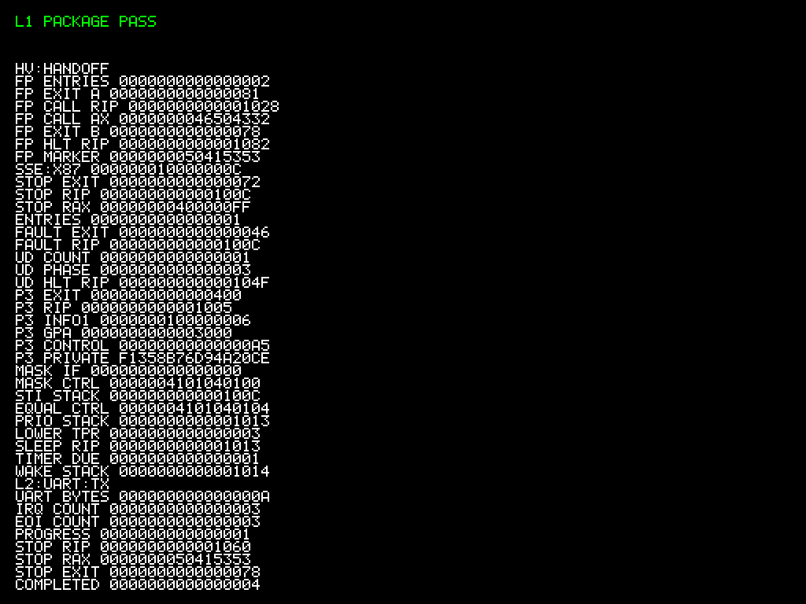

The [test ledger](test-report.md#041--2026-11-25--standalone-runtime-package-and-two-processor-control) includes the separate two-processor control, the media hashes, and why the queue ended `ATTENTION` even though the firmware passed. This is a fixed guest, not a Linux boot.

## 040 · 2026-11-25 · One guest address reads two different backing frames

**Passed in `HV-SVM-L1`.** The same guest load from GPA `0x2000` returned `0xA11A`, then `0xB22B` after the standalone L1 changed the backing frame and requested a local translation flush. Both entries reached the same halt. L1 independently read the two backing words and found both original markers intact: this was a mapping change, not a rewrite of the data.

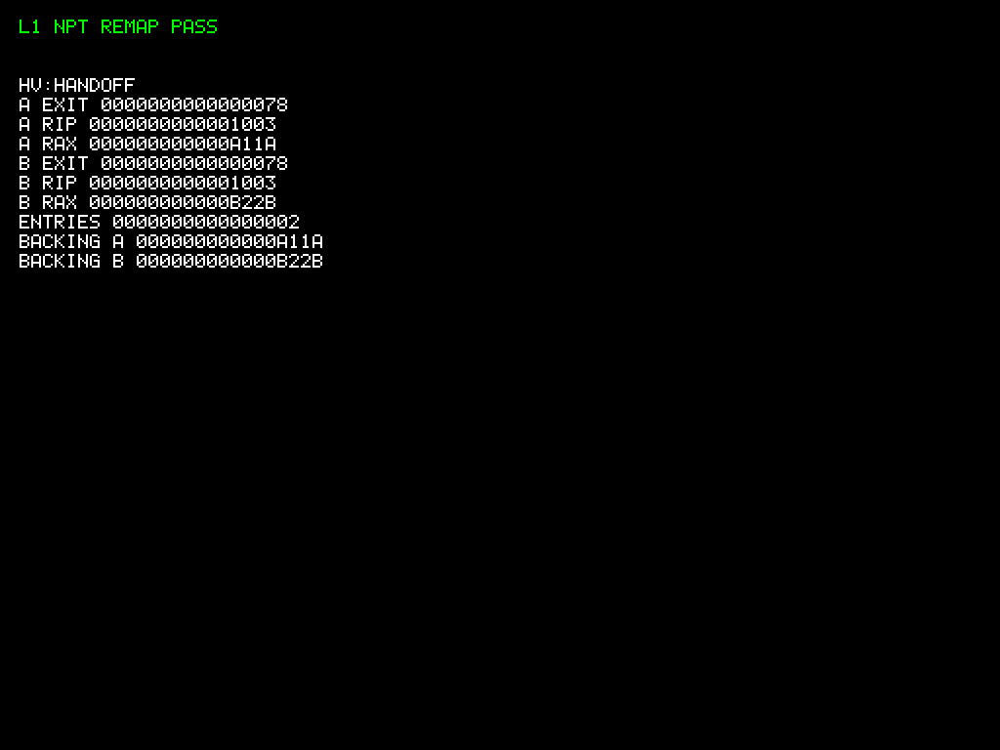

This was the fifth boot in one supervised batch. Handoff (including COM1), L2 entry, CPUID resume, and write protection passed before the new remap screen stopped the queue for review. The [ledger](test-report.md#040--2026-11-25-local--standalone-backing-frame-remap-and-baseline-batch) records all five image digests.

## 039 · 2026-11-25 · Standalone L1 revokes write access to a live guest mapping

**Passed in `HV-SVM-L1`.** With the mapping writable, the guest stored `0xA5` at GPA `0x2000` and reached `HLT`. L1 reset the byte to `0x5A`, made the same backing page read-only, and requested a local translation flush on re-entry. The identical store then faulted at its first byte (`RIP=0x1000`). L1 read the backing byte directly: `0x5A` before and after.

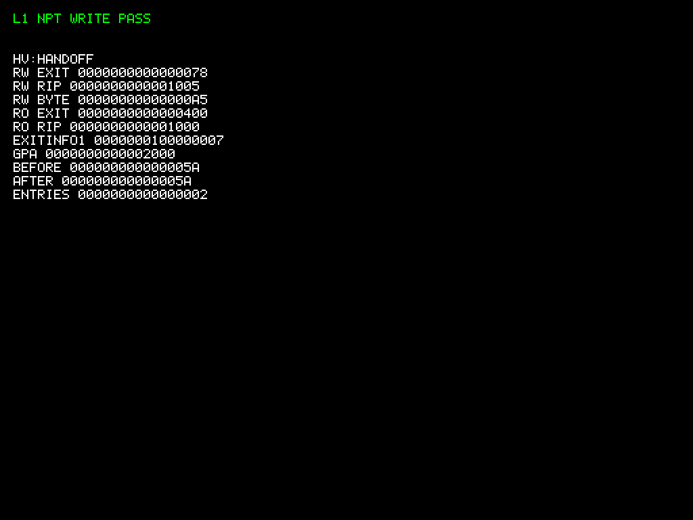

The [test record](test-report.md#039--2026-11-25-local--standalone-l1-npt-write-protection) gives the raw fault fields and image hash. This checks write revocation on one vCPU, not remote invalidation.

## 038 · 2026-11-25 · L2 consumes a CPUID reply after standalone L1 resumes it

**Passed in `HV-SVM-L1`.** After `ExitBootServices`, L1 intercepted the guest's fixed CPUID request at `0x100C` and used the reported next RIP, `0x100E`, to resume the same vCPU. L2 compared EAX, EBX, ECX and EDX against four distinct constants. Only the matching path could set the `PASS` marker and reach the halt at `0x1037`; seeing a second exit alone was not enough.

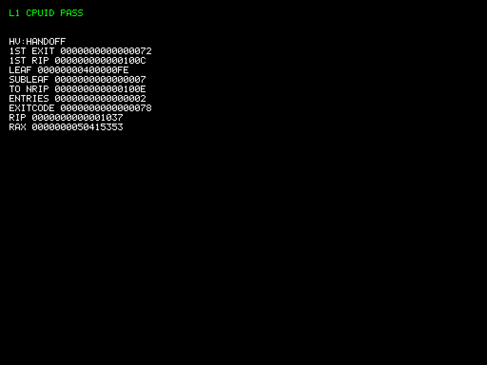

The [test record](test-report.md#038--2026-11-25-local--standalone-l1-cpuid-resume) includes the command, media hash and both exits. The fixed-length fallback for CPUs without next-RIP reporting was not exercised.

## 037 · 2026-11-25 · The standalone L1 launches its first L2 guest

**Passed in `HV-SVM-L1`.** After leaving UEFI boot services, L1 used its own arena to build the VMCB and nested page tables. It mapped just one read-only guest page at `0x1000`. L2 set AX to `0x4C32` and halted. L1 regained control and read the marker from the VMCB, with the saved RIP pointing at the `HLT` instruction itself.

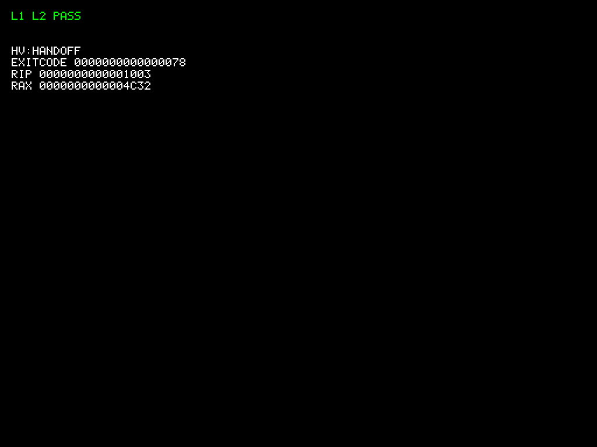

This was one guest entry and one exit, not a guest resume. The [test record](test-report.md#037--2026-11-25-local--one-l2-entry-from-the-standalone-l1) includes the exact image, run command and memory layout.

## 036 · 2026-11-25 · L1 reports an allocation failure after UEFI handoff

**Passed in `HV-SVM-L1`.** After `ExitBootServices`, L1 switched to its private stack and verified a page from its own arena. It rejected a nine-page request without advancing the allocator: the next one-page allocation returned exactly the second arena page. The worker received all four expected lines on COM1, and the VM framebuffer independently displayed the terminal below.

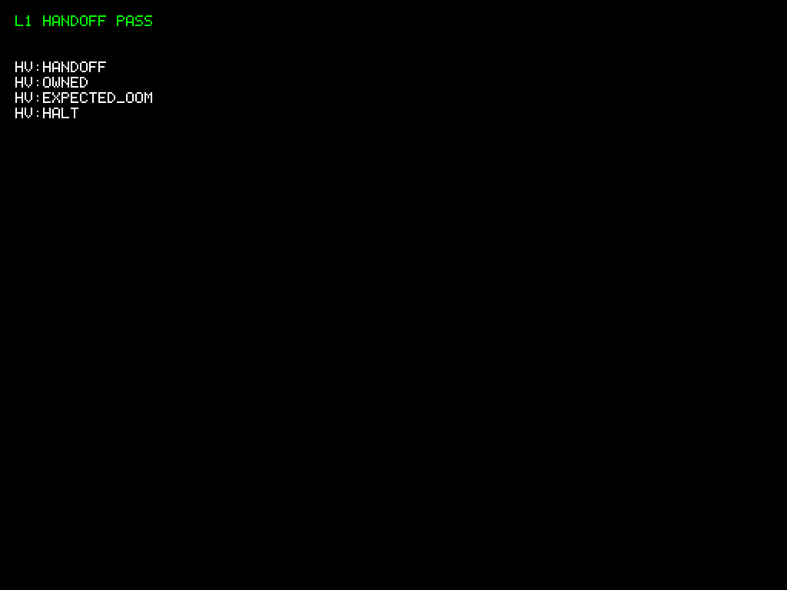

The queue stopped for first-time screen review. The [run record](test-report.md#036--2026-11-25-local--standalone-l1-handoff) identifies the tested image and serial bytes. No L2 guest or bare-metal boot was part of this test.

## 034–035 · 2026-11-25 · First direct L1 memory handoff image

**Image built; VM acceptance pending.** The new profile tests whether L1 can allocate memory, reject an oversized request, and report the outcome over COM1 after leaving UEFI boot services. The first build failed to link; the corrected image staged, but Windows canceled the worker elevation before any VM operation. There is no guest screenshot or serial result for these attempts. The [ledger](test-report.md#035--2026-11-25-local--standalone-l1-handoff-staged-not-booted) records the image digest and the exact criteria for the first boot.

## 032–033 · 2026-11-25 · One vCPU switches integer and floating-point state together

**Run 033 passed in `HV-SVM-L1`.** L2 changed its integer registers, XMM registers, x87 stack and rounding controls, then exited through `VMMCALL`. On resume it used the two preserved x87 values, `5` and `6`, to round `5 + 6 + 0.25` up to `12`. A separate SSE conversion rounded `0.25` up to `1` using MXCSR. The host recovered its own values after each exit. Restoring the guest's *initial* state would not have passed.

Reproduce with `python lab/hv_queue.py run --session --rebuild vcpu-fpstate`. The [ledger](test-report.md#033--2026-11-25-local--integrated-legacy-vcpu-context) records the image, exit addresses, and limits of this fixed guest. Run 032 stopped at assembly and did not change the VM.

## 029–030 · 2026-11-25 · Guest rounding mode survives a VM exit

**Run 030 passed in `HV-SVM-L1`.** L2 rounded `1.5` down to integer `1`, changed its mode to round up, and executed `VMMCALL`. After resume, the same conversion produced `2`. Each conversion set only the precision flag. L1 read its own live MXCSR after each exit and found its original rounding mode and status flags, not the guest's.

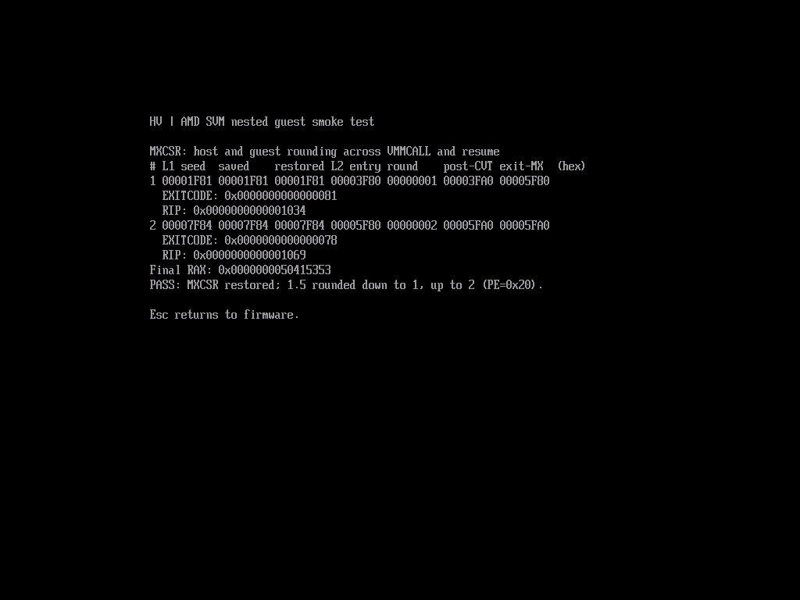

Reproduce with `python lab/hv_queue.py run --rebuild vcpu-mxcsr`. The [test record](test-report.md#030--2026-11-25-local--mxcsr-rounding-and-status-preservation) includes both exits; run 029 stopped during compilation without changing the VM.

## 028 · 2026-11-25 · Host and guest retain separate XMM registers

**Run 028 passed in `HV-SVM-L1`.** L2 checked both halves of XMM0–XMM15 on entry, wrote a different pattern, and exited through `VMMCALL`. On resume it found its own updated values, not the host's values or its initial pattern. It then wrote a third pattern and reached its success HLT. L1 sampled its live registers after each return: all 32 lanes matched its own pattern for that entry.

Reproduce with `python lab/hv_queue.py run --rebuild vcpu-xmm`. The [test record](test-report.md#028--2026-11-25-local--legacy-xmm-register-preservation) includes the measured lane values and the scope of the result.

## 027 · 2026-11-24 · The guest handles an invalid opcode and returns

**Run 027 passed in `HV-SVM-L1`.** L2 executed `UD2` at `0x100C`. L1 intercepted `#UD` and delivered vector 6 without advancing the guest RIP. The guest handler ran once and found `0x100C` on its exception stack, not the address after the fault. Only the handler moved that saved address past the two-byte `UD2`. After `IRETQ`, L2 checked its restored stack and reached the success halt at `0x104F`.

Reproduce with `python lab/hv_queue.py run --rebuild exception-ud`. See the [test record](test-report.md#027--2026-11-24-local--invalid-opcode-delivery-and-return) for the injection fields and image digest.

## 026 · 2026-11-24 · Equal interrupt priority stays pending

**Run 026 passed in `HV-SVM-L1`.** At `V_TPR=4`, a queued priority-4 interrupt remained pending even though guest interrupts were enabled and there was no interrupt shadow. The handler count was zero. L1 lowered `V_TPR` to 3 without queuing another interrupt. The handler ran once and saved return RIP `0x100F`, the first instruction after the checkpoint. The guest returned from the handler, recorded progress and halted.

Reproduce with `python lab/hv_queue.py run --rebuild irq-priority`. The [ledger](test-report.md#026--2026-11-24-local--virtual-interrupt-priority-threshold) distinguishes the firmware result from the queue's first-screen review stop.

## 023–025 · 2026-11-24 · A pending IRQ waits for the STI shadow

**Run 025 passed in `HV-SVM-L1`.** L1 queued vector `0x41` once. At a guest checkpoint with interrupts disabled, the IRQ was still pending and the handler count was zero. L1 resumed L2 without requeuing it. The instruction after `STI` incremented a phase counter. The interrupt handler saw the increment and recorded `0x1018` as its return address: exactly the next instruction.

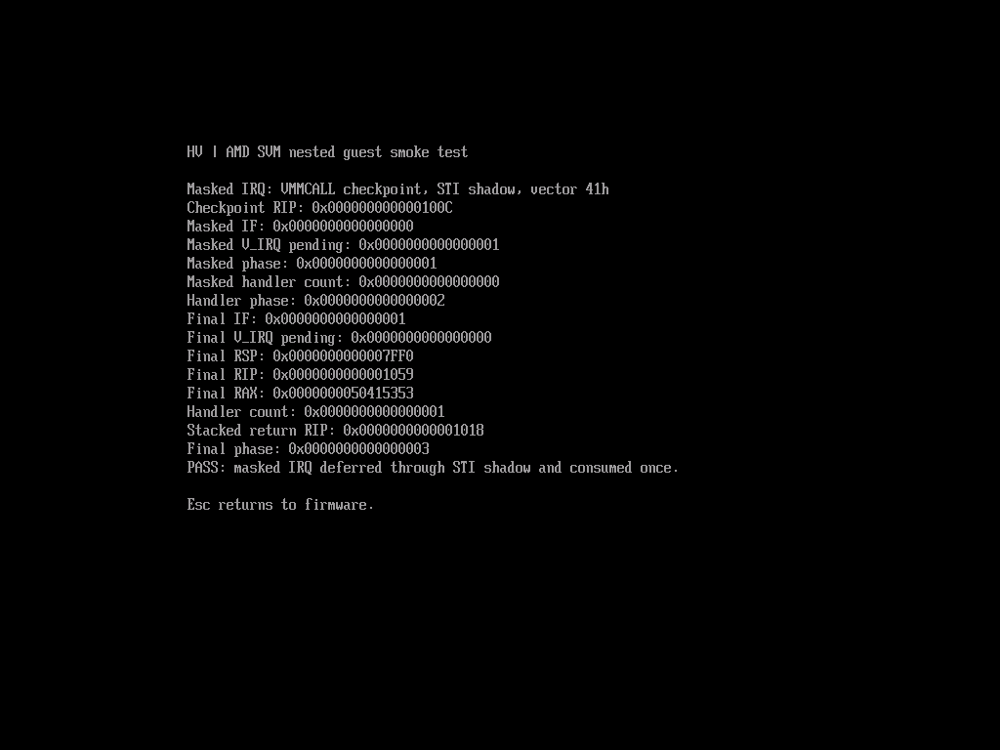

After `IRETQ`, the guest reached phase 3 and halted with its PASS marker. Run `python lab/hv_queue.py run --rebuild irq-shadow` to reproduce. The [ledger](test-report.md#025--2026-11-24-local--pending-vector-delivered-after-the-sti-shadow) records the image, registers, and two earlier build errors that did not touch the VM.

## 021–022 · 2026-11-24 · One interrupt wakes a virtual CPU

**Run 022 passed in `HV-SVM-L1`.** L2 reached HLT at `0x1002` with interrupts enabled, no handler entries, and no progress past HLT. L1 queued vector `0x41`. The guest handler ran once and recorded `0x1003` on its interrupt stack: the instruction immediately after HLT. After `IRETQ`, the guest checked its stack pointer, recorded forward progress and reached the success HLT at `0x1039`.

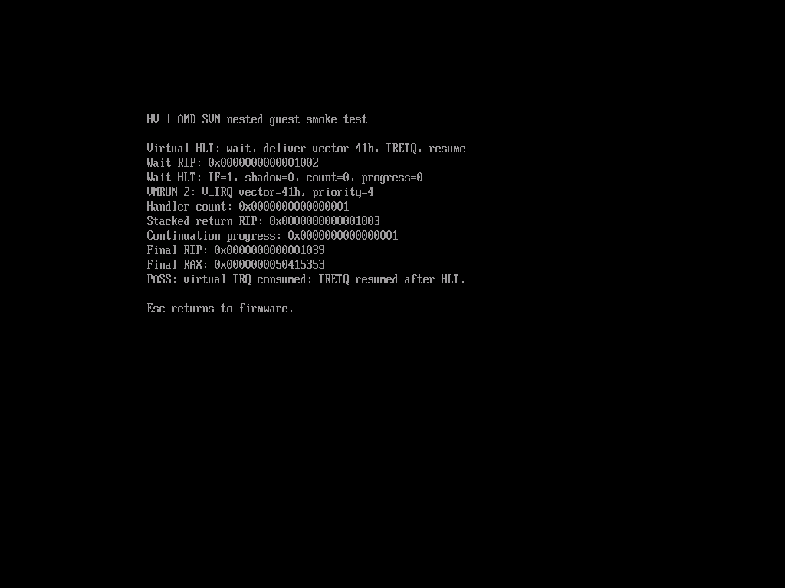

The [ledger](test-report.md#022--2026-11-24-local--one-virtual-interrupt-wakes-l2) preserves the first fixture failure and corrected run separately. To reproduce: `python lab/hv_queue.py run --rebuild irq-wake`. This is an emulated guest halt and virtual interrupt, not a physical CPU sleep or a timer test.

## 019–020 · 2026-11-24 · A 64-bit vCPU keeps its integer registers across exits

**Run 020 passed in `HV-SVM-L1`.** After each of two CPUID intercepts, L2 checked the four emulated replies and all twelve other integer registers, including RSP. Different values in the second round prevent a stale first-round frame from passing. Only after both checks did the guest set `RAX=0x50415353` and reach the success HLT.

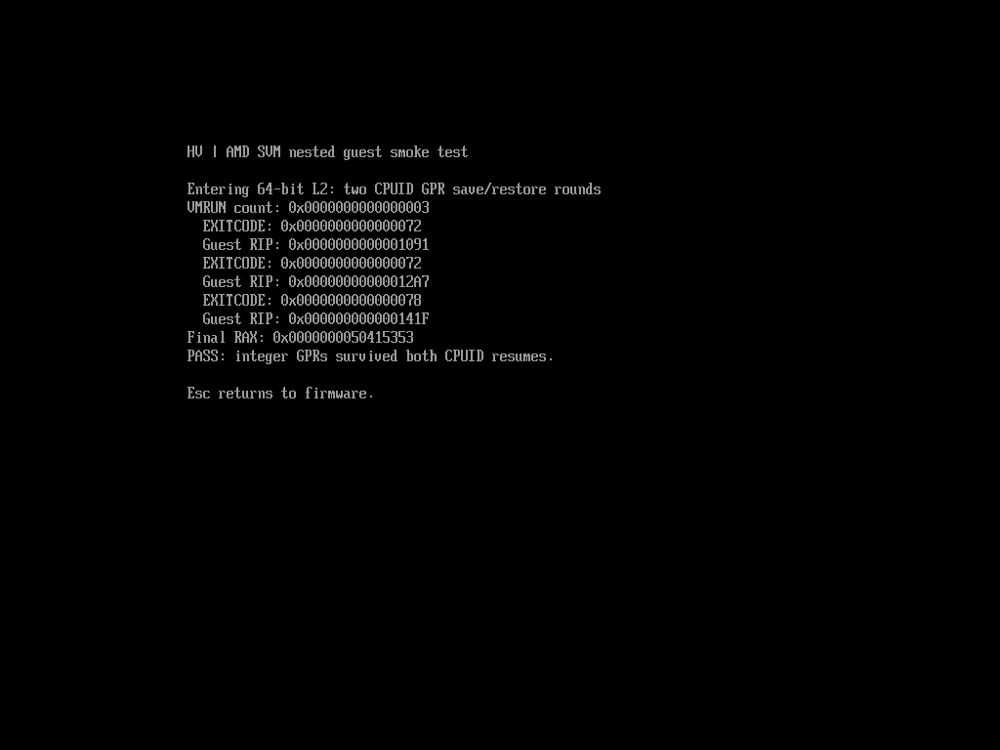

Run: `python lab/hv_queue.py run --rebuild vcpu-gpr`. The [ledger](test-report.md#020--2026-11-24-local--two-64-bit-register-round-trips) records the earlier assembler error separately from the live run. This is one vCPU on the nested 9950X lab; SIMD/FPU state, interrupt delivery and physical hardware were not tested.

## 018 · 2026-11-24 · Distinguishing an attempted write from a committed write

**PASS in `HV-SVM-L1`.** With writes allowed, L2 stored `0xA5` and reached HLT. With the same page read-only, L1 reported a write protection fault. The instruction at the saved RIP decoded as `MOV byte [0x2000], 0xA5`; its destination matched the fault address reported by the processor. A separate read of the backing byte showed `0x5A` both before and after the attempt.

Run: `python lab/hv_queue.py run --rebuild forensic-write`. The queue stopped for first-time screen review. [Run 018](test-report.md#018--2026-11-24-local--forensic-write-protection) records the exact image and exit fields. This verifies one fixed 16-bit instruction under nested Hyper-V, not general-purpose instruction decoding.

## 017 · 2026-11-24 · One nested GPA flush for both processors

**PASS in `HV-SVM-L1`.** Both L2s read `0xA11A` at GPA `0x2000` and halted. With both stopped, L1 remapped the page. Processor 0 issued a single Hyper-V all-processor flush for the shared NPT root and received status `0`. On re-entry, neither processor requested a local flush. Both read `0xB22B`.

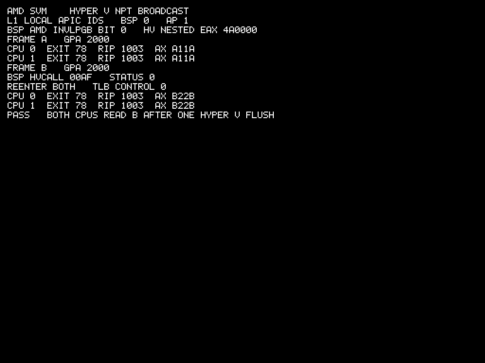

Run: `python lab/hv_queue.py run --rebuild npt-broadcast`. Hyper-V did **not** advertise native AMD `INVLPGB` to the L1 bootstrap processor. This tests the Hyper-V interface, not a physical broadcast instruction or interruption of a running guest. The queue stopped for first-time screen review; [run 017](test-report.md#017--2026-11-24-local--one-all-processor-nested-gpa-flush) records the image and verdict.

## 015–016 · 2026-11-24 · Two L1 processors see the new frame

The earlier UEFI image could not start a second processor. The new `npt-cross` image uses Limine's multiprocessor handoff instead. Code running on each L1 processor reported its own APIC ID before either entered L2: **0 on the bootstrap processor and 1 on the application processor**.

Both processors read `0xA11A` from GPA `0x2000`. With both guests stopped, L1 replaced the backing frame. Each processor requested its own local flush and read `0xB22B` from the same address. All four reads reached the expected HLT. The [test report](test-report.md) distinguishes the guest result from the queue's first-time screen review.

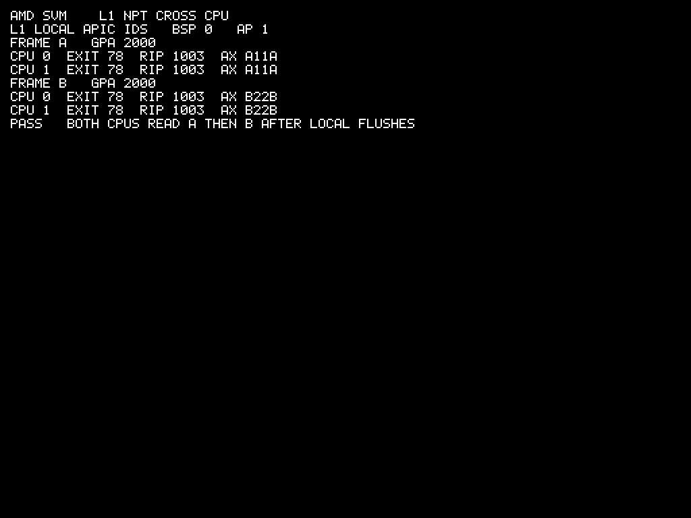

After reviewing that screen, we booted the halt-only image and then booted `npt-cross` again. Both profiles passed and the supervised queue reported COMPLETE.

## 011–013 · 2026-11-24 · Watch a regression batch and veto its next boot

The [supervised runner](../lab/README.md) booted four known-good images in sequence, matched each live guest console, then stopped on the cross-vCPU image's known SKIP. A second batch verified the operator control: after `npt-remap` passed, a stop request during the `l2` countdown ended the batch without mounting or starting `l2`. The remap guest was left on its success screen.

The [test report](test-report.md) distinguishes a stopped queue from a failing guest and links the independently captured [attention screen](images/queue-012-skip.png). Cross-vCPU invalidation remains unverified.

## 010 · 2026-11-24 · Cross-vCPU invalidation blocked before guest entry

The new test image booted in `HV-SVM-L1`, configured with two virtual processors and nested virtualization enabled. Its firmware could not locate UEFI MP Services, the interface the test uses to run a callback on a second processor. The result was **SKIP**, not a failed invalidation or a pass: neither processor executed the test guest.

The [test report](test-report.md) records the image hash, replay commands, earlier build failure and the evidence needed to close this gap. Run 008 remains the last verified remap and covers one vCPU only.

## 008 · 2026-11-24 · Same guest address, different backing frame

L2 read `0xA11A` from guest physical address `0x2000`. L1 then pointed the same read-only mapping at a second frame, requested a full TLB flush, and restarted the guest at the same load. L2 read `0xB22B`. Neither frame's contents changed between reads, and both runs reached the same HLT at `0x1003`.

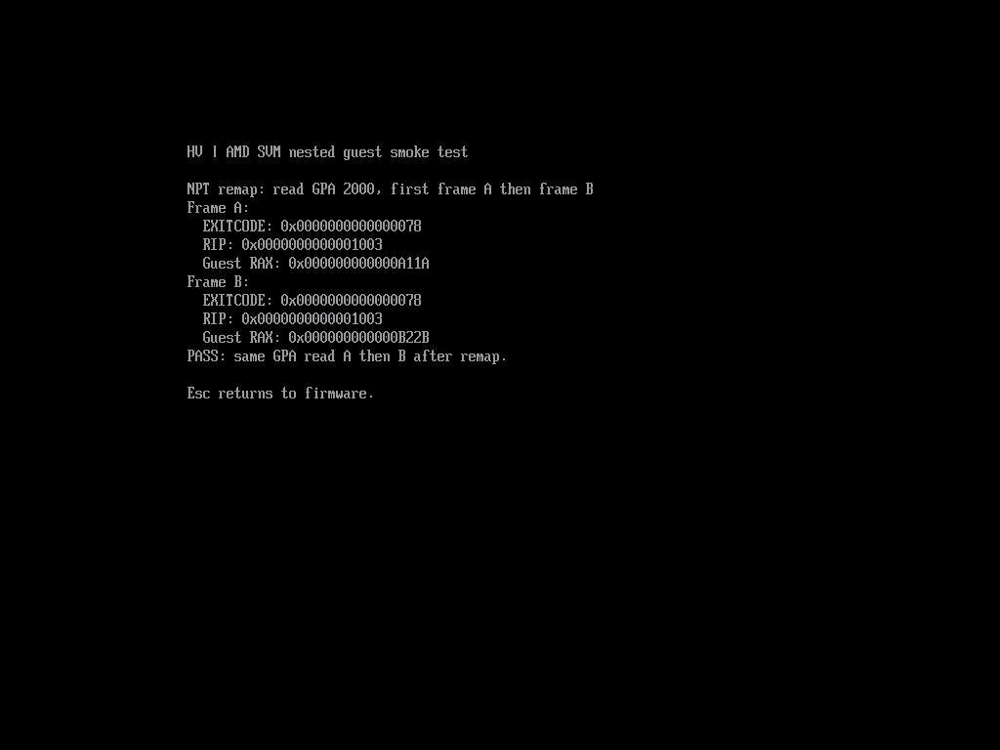

The [test report](test-report.md) records the image hash and replay commands. This verifies frame replacement on one nested vCPU, not invalidation across CPUs.

## 007 · 2026-11-24 · The same guest store succeeds, then faults

Run 004 checked the page tables in memory. Run 007 checked what happened when L2 actually used them. With the target page writable, the guest changed its byte from `0x5A` to `0xA5` and reached HLT. L1 restored `0x5A`, made that same page read-only, flushed the translation and restarted at the same instruction. This time the store produced a nested write protection fault at GPA `0x2000`; the byte stayed `0x5A`.

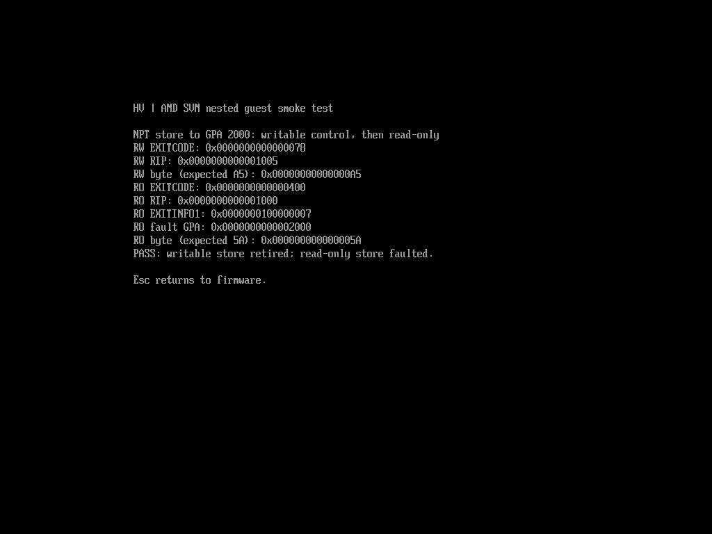

The [test report](test-report.md) records the exact ISO, commands and exit fields. Next test: replace the backing frame without changing the guest physical address and verify which frame the guest reads.

## 004–006 · 2026-11-24 · Check the nested page tables before entering L2

Both guests execute from one page at guest physical address `0x1000`. We extracted the table builder used by the firmware so a host program can inspect its output without entering a VM. The host test used different physical addresses for the tables and code, checked every slot, and found exactly one read-only leaf. Rebuilt halt and CPUID guests then reproduced their earlier results in Hyper-V.

The [test report](test-report.md) ties each run to the source commit, binary hash and [host output](npt-layout-004.txt), [halt screenshot](images/npt-005.png) or [resume screenshot](images/npt-006.png). **Still open:** neither guest attempted a store. A writable control and an observed nested protection fault on the read-only page are needed before claiming write enforcement.

## 003 · 2026-11-24 · Resume after CPUID

**Question:** Can L1 emulate an instruction and resume the same vCPU with all four result registers intact?

**Run:** `firmware\build.cmd cpuid`. With the lab VM off, mount and start the image using `lab\Boot-HvProbe.ps1 -CpuidResume` in elevated PowerShell.

**Result:** CPUID exit `0x72` at `0x100C`, leaf `0x400000FE`, subleaf `7`. The reported next RIP was `0x100E`. L2 checked EAX, EBX, ECX and EDX, wrote `0x50415353` (“PASS”), then halted at `0x1037` with exit `0x78`. Exactly two guest entries. The no-nRIP fallback was not exercised.

## 002 · 2026-11-24 · First L2 guest

**Question:** Can the UEFI application temporarily enable SVM, enter a guest and regain control on HLT?

**Run:** `firmware\build.cmd l2`; `lab\Boot-HvProbe.ps1 -L2Smoke` with the VM off. The fixed guest executed `MOV AX,4C32h; HLT` from a single read-only nested page.

**Result:** Guest `RAX=0x4C32`, `RIP=0x1003`, `EXITCODE=0x78`. The marker shows that the instruction before HLT actually ran.

## 001 · 2026-11-24 · Boot our own UEFI image

**Question:** Does our own x86-64 EFI application boot and see AMD SVM in the lab VM?

**Run:** `firmware\build.cmd`; `lab\Boot-HvProbe.ps1` from elevated PowerShell.

**Result:** UEFI console reported `AuthenticAMD`, `CPUID.80000001h:ECX=0x004003F7` and SVM revision `1`. This was a read-only capability probe; no L2 guest was launched.

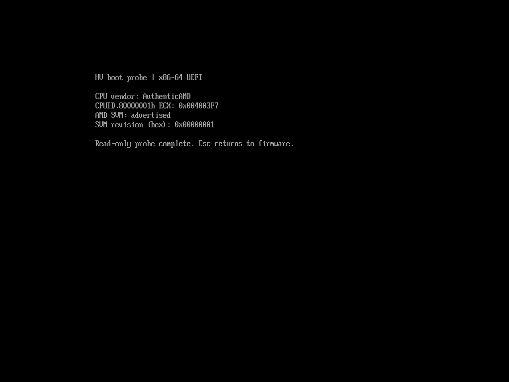

---

**Adding an entry:** Put the next numbered entry at the top. Record the date, machine or VM, question, build/run command, observed result and any untested condition. Failures belong here too. For a screenshot, save a reviewed PNG under `journal/images/` and embed it with ``. Keep credentials, personal desktop content, VM disks and raw logs out of the repository.
