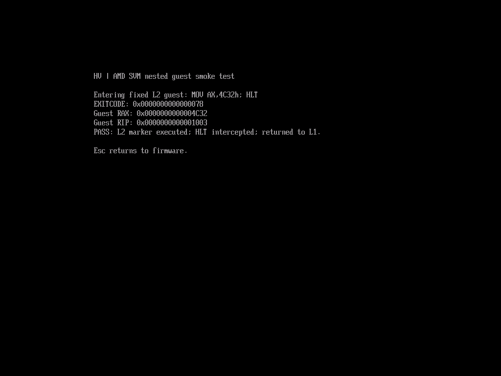

# Hypervisor development journal

Development host: Ryzen 9 9950X. Firmware runs use the `HV-SVM-L1` Hyper-V VM; host-only checks are labeled separately. Neither qualifies the 9950X3D deployment target on bare metal.

## 015–016 · 2026-11-24 · Two L1 processors see the new frame

The earlier UEFI image could not start a second processor. The new `npt-cross` image uses Limine's multiprocessor handoff instead. Code running on each L1 processor reported its own APIC ID before either entered L2: **0 on the bootstrap processor and 1 on the application processor**.

Both processors read `0xA11A` from GPA `0x2000`. With both guests stopped, L1 replaced the backing frame. Each processor requested its own local flush and read `0xB22B` from the same address. All four reads reached the expected HLT. The [test report](test-report.md) distinguishes the guest result from the queue's first-time screen review.

After reviewing that screen, we booted the halt-only image and then booted `npt-cross` again. Both profiles passed and the supervised queue reported COMPLETE.

## 011–013 · 2026-11-24 · Watch a regression batch and veto its next boot

The [supervised runner](../lab/README.md) booted four known-good images in sequence, matched each live guest console, then stopped on the cross-vCPU image's known SKIP. A second batch verified the operator control: after `npt-remap` passed, a stop request during the `l2` countdown ended the batch without mounting or starting `l2`. The remap guest was left on its success screen.

The [test report](test-report.md) distinguishes a stopped queue from a failing guest and links the independently captured [attention screen](images/queue-012-skip.png). Cross-vCPU invalidation remains unverified.

## 010 · 2026-11-24 · Cross-vCPU invalidation blocked before guest entry

The new test image booted in `HV-SVM-L1`, configured with two virtual processors and nested virtualization enabled. Its firmware could not locate UEFI MP Services, the interface the test uses to run a callback on a second processor. The result was **SKIP**, not a failed invalidation or a pass: neither processor executed the test guest.

The [test report](test-report.md) records the image hash, replay commands, earlier build failure and the evidence needed to close this gap. Run 008 remains the last verified remap and covers one vCPU only.

## 008 · 2026-11-24 · Same guest address, different backing frame

L2 read `0xA11A` from guest physical address `0x2000`. L1 then pointed the same read-only mapping at a second frame, requested a full TLB flush, and restarted the guest at the same load. L2 read `0xB22B`. Neither frame's contents changed between reads, and both runs reached the same HLT at `0x1003`.

The [test report](test-report.md) records the image hash and replay commands. This verifies frame replacement on one nested vCPU, not invalidation across CPUs.

## 007 · 2026-11-24 · The same guest store succeeds, then faults

Run 004 checked the page tables in memory. Run 007 checked what happened when L2 actually used them. With the target page writable, the guest changed its byte from `0x5A` to `0xA5` and reached HLT. L1 restored `0x5A`, made that same page read-only, flushed the translation and restarted at the same instruction. This time the store produced a nested write protection fault at GPA `0x2000`; the byte stayed `0x5A`.

The [test report](test-report.md) records the exact ISO, commands and exit fields. Next test: replace the backing frame without changing the guest physical address and verify which frame the guest reads.

## 004–006 · 2026-11-24 · Check the nested page tables before entering L2

Both guests execute from one page at guest physical address `0x1000`. We extracted the table builder used by the firmware so a host program can inspect its output without entering a VM. The host test used different physical addresses for the tables and code, checked every slot, and found exactly one read-only leaf. Rebuilt halt and CPUID guests then reproduced their earlier results in Hyper-V.

The [test report](test-report.md) ties each run to the source commit, binary hash and [host output](npt-layout-004.txt), [halt screenshot](images/npt-005.png) or [resume screenshot](images/npt-006.png). **Still open:** neither guest attempted a store. A writable control and an observed nested protection fault on the read-only page are needed before claiming write enforcement.

## 003 · 2026-11-24 · Resume after CPUID

**Question:** Can L1 emulate an instruction and resume the same vCPU with all four result registers intact?

**Run:** `firmware\build.cmd cpuid`. With the lab VM off, mount and start the image using `lab\Boot-HvProbe.ps1 -CpuidResume` in elevated PowerShell.

**Result:** CPUID exit `0x72` at `0x100C`, leaf `0x400000FE`, subleaf `7`. The reported next RIP was `0x100E`. L2 checked EAX, EBX, ECX and EDX, wrote `0x50415353` (“PASS”), then halted at `0x1037` with exit `0x78`. Exactly two guest entries. The no-nRIP fallback was not exercised.

## 002 · 2026-11-24 · First L2 guest

**Question:** Can the UEFI application temporarily enable SVM, enter a guest and regain control on HLT?

**Run:** `firmware\build.cmd l2`; `lab\Boot-HvProbe.ps1 -L2Smoke` with the VM off. The fixed guest executed `MOV AX,4C32h; HLT` from a single read-only nested page.

**Result:** Guest `RAX=0x4C32`, `RIP=0x1003`, `EXITCODE=0x78`. The marker shows that the instruction before HLT actually ran.

## 001 · 2026-11-24 · Boot our own UEFI image

**Question:** Does our own x86-64 EFI application boot and see AMD SVM in the lab VM?

**Run:** `firmware\build.cmd`; `lab\Boot-HvProbe.ps1` from elevated PowerShell.

**Result:** UEFI console reported `AuthenticAMD`, `CPUID.80000001h:ECX=0x004003F7` and SVM revision `1`. This was a read-only capability probe; no L2 guest was launched.

---

**Adding an entry:** Put the next numbered entry at the top. Record the date, machine or VM, question, build/run command, observed result and any untested condition. Failures belong here too. For a screenshot, save a reviewed PNG under `journal/images/` and embed it with ``. Keep credentials, personal desktop content, VM disks and raw logs out of the repository.
