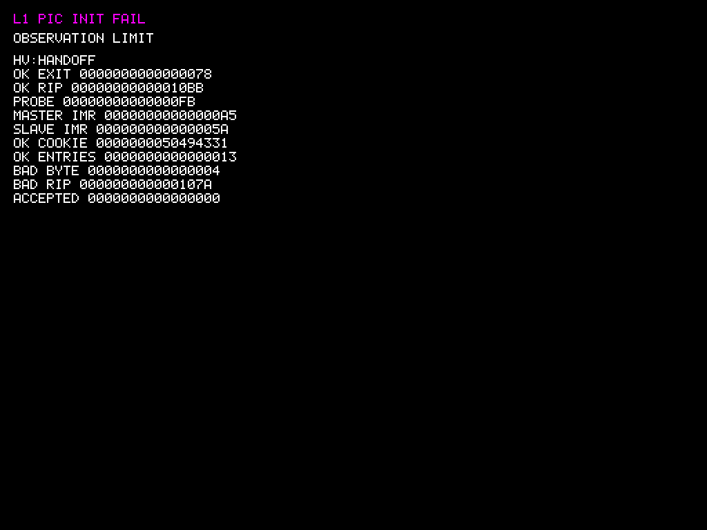

# 068 · Guest probe and initialization of the legacy PIC pair

**Preboot contract:** The fixed guest must read `FBh` back at the master data port during the probe, then program distinct master/slave ICWs (`11/30/04/01`, `11/38/02/01`) without one chip consuming the other's pending word. Require independent guest readback of distinguishable restored masks and a completion witness. A matched bad partial initialization must be refused with the peer intact, no IP advance or further entry, and no success cookie. No host port traffic, actual Linux probe, interrupt arbitration or interrupt delivery is inferred.

**2026-11-25 · FAIL; lane A held.** `firmware\build.cmd l1-pic-init`, then `python lab/hv_queue.py run --session l1-pic-init` on `HV-SVM-L1-A`. Batch `6cc40403f4154046b6e364e7eba637d2`; source `377df490f0`; ISO SHA-256 `2309ec6b82575fb6cffc5fec823563939a058236a2b48edaf5c9a57497a77dff`. The terminal showed `L1 PIC INIT FAIL / OBSERVATION LIMIT`; queue `ATTENTION` after 60 seconds. No PASS pin or retry.

The positive arm reached HLT (`78h`) at `10BBh`, probe `FBh`, masks `A5h/5Ah`, cookie `50494331h`, `13h` entries. The negative arm showed byte `04h` at `107Ah`, accepted `0`. The final chip states, cookie and entry count were **not displayed**. Refusal alone is insufficient. Next: inspect the host row formatter with the first missing label `MASTER STATE ` (13 characters including space) and check remaining evidence capacity; do not change the guest oracle.

