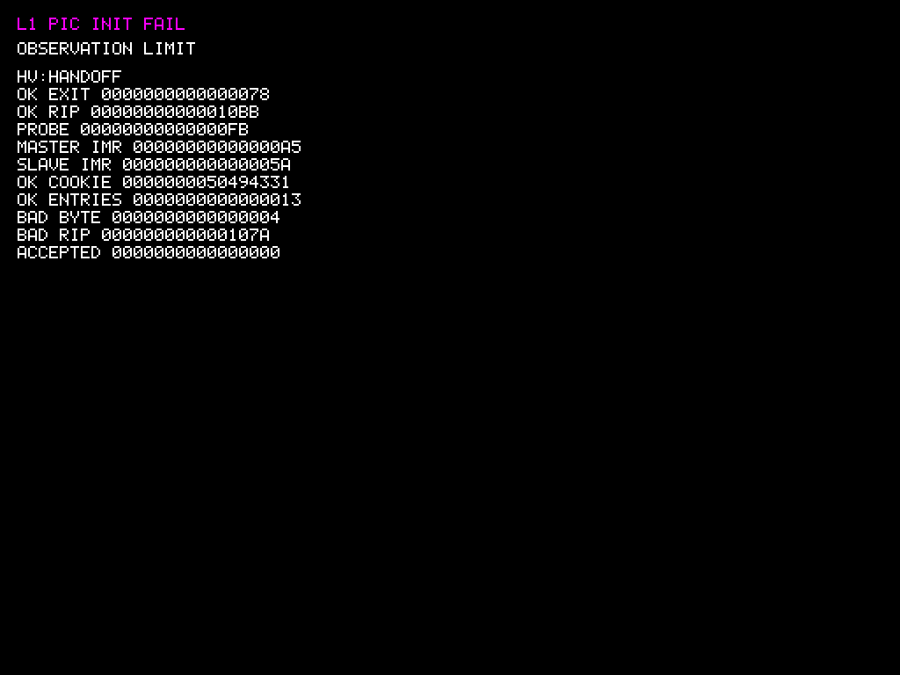

# 068 · PIC initialization — FAIL (observation limit)

2026-11-25 · [work item #14](https://github.com/kuro1337WStuff/hv/issues/14) · [implementation PR #12](https://github.com/kuro1337WStuff/hv/pull/12) · tested revision `377df490f0`. Nested 9950X, lane A; `firmware\build.cmd l1-pic-init` then `python lab/hv_queue.py run --session l1-pic-init`. Batch `6cc40403f4154046b6e364e7eba637d2`; ISO SHA-256 `2309ec6b82575fb6cffc5fec823563939a058236a2b48edaf5c9a57497a77dff`.

The fixed guest reached HLT at `10BBh` after `13h` entries, with probe `FBh`, mask readbacks `A5h` and `5Ah`, and cookie `50494331h`. The refusal arm showed `04h` at `107Ah`, accepted `0`. **Missing:** both final chip states, unchanged cookie and entry count. The live console ended `L1 PIC INIT FAIL / OBSERVATION LIMIT`; the queue ended `ATTENTION`. Lane held, no PASS pin, no retry. Next: host-only check of the first missing label's width and total row capacity. Not an interrupt-delivery or Linux qualification.

