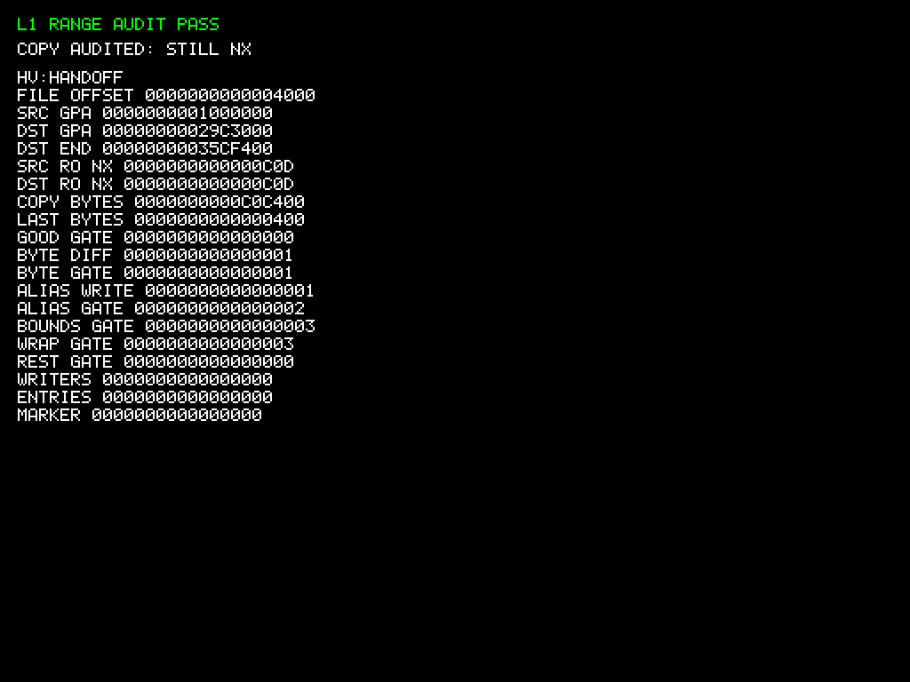

# 070 · Board-selected whole-range regression — COMPLETE

2026-11-25 · [work item #17](https://github.com/kuro1337WStuff/hv/issues/17) · [supervisor PR #18](https://github.com/kuro1337WStuff/hv/pull/18), `68a5723f92`; trusted runner `56db7a855d`. Command: `python lab/hv_plan.py run BOARD --max-cards 2 --minutes 5`. `BOARD` is the local task board. `R71` was blocked on `R70` when the invocation began.

Nested lane B booted the unchanged [067 fixed range-audit image](https://github.com/kuro1337WStuff/hv/blob/89de7b5fe740772b37f1bf88426d8bf38b414ced/journal/runs/067-l1-range-audit.md); batch `6498a9f2b324475499b9d78772f513ad`, ISO SHA-256 `27d9ba4a34859fc8bcb69e875b5aadf5a6cb0116b1939c68699b298886bb2b1b`. The broker saw fresh `PASS` then `COMPLETE`. Returned pixels matched reviewed RGB565 SHA-256 `89d6c8a3c97187e80f2be809b6a669dbe6828be32fed31465affd6faac90b5ff`. No general loader execution. The supervisor persisted the receipt, read the board again and released [071](071.md).

