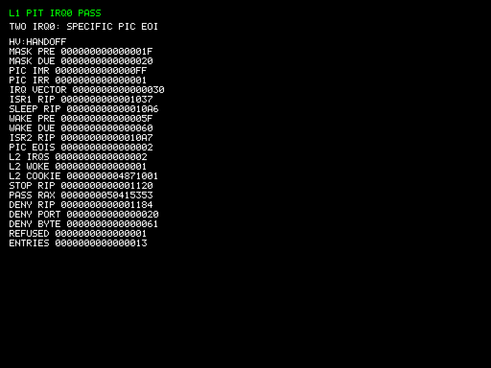

# 071 · Dependent fixed IRQ0 regression — COMPLETE

2026-11-25 · [work item #17](https://github.com/kuro1337WStuff/hv/issues/17) · [supervisor PR #18](https://github.com/kuro1337WStuff/hv/pull/18), `68a5723f92`; trusted runner `56db7a855d`. Same bounded invocation as [070](070.md), separate cold boot on nested lane B. Card `R71` was admitted only after the prior completion and board reload.

Batch `1af8929f2f5b4f598485e390918bef90`; frozen `l1-pit-irq0` ISO SHA-256 `74e954b1324fa85d738291bf49c061e279e4d7ea00ea4e40800c864fe2a38045`. The broker observed fresh `PASS` then `COMPLETE`; returned pixels matched reviewed RGB565 SHA-256 `79734331bc020f614d514f1fdb94b7f5b772e5f39d7c41e909363d8e3a2cce9c`. The final scan found 12 outstanding cards: two manual gates, ten dependency-blocked, none eligible. No Linux timer, physical deployment or release claim; no third boot.

