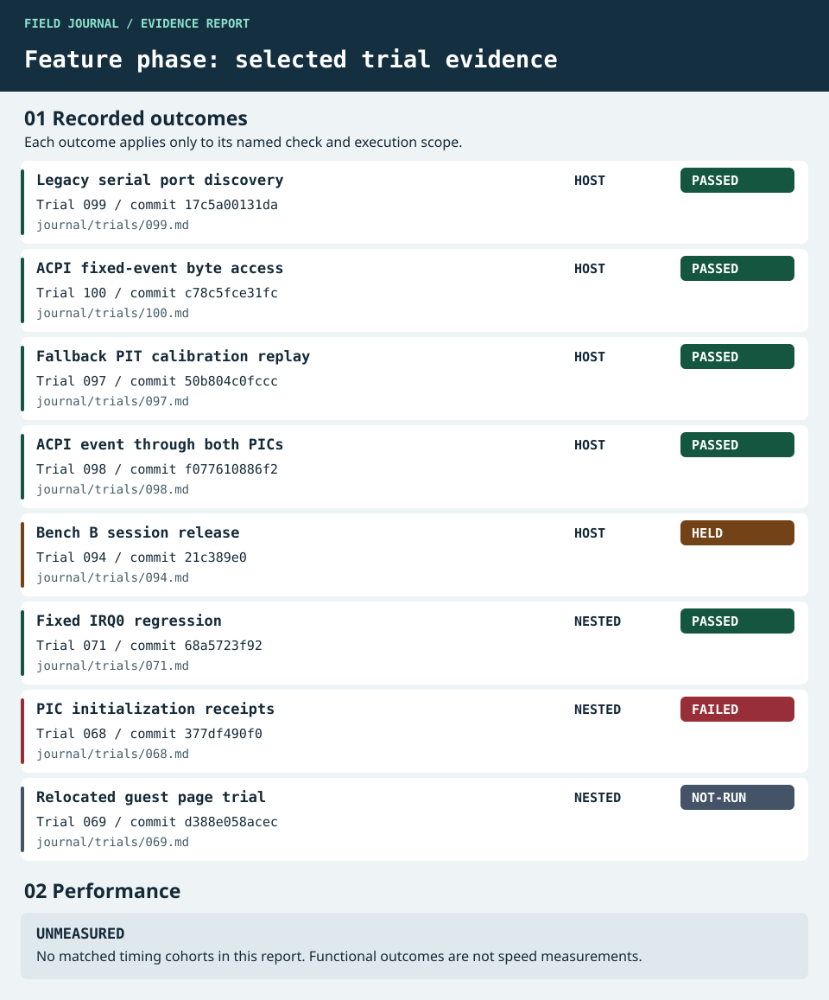

# 101 · A reproducible feature-phase journal report

**PASS — host reporting tool. No hypervisor speed measurement.** The [input ledger](../reports/feature-phase.json) references eight actual trials. The figure separates host from nested results and keeps the PIC failure, bench hold and unrun loader case visible. It is a selected evidence set, not a feature completeness score. No guest was run for this report.



[Reservation](https://github.com/kuro1337WStuff/hv/issues/13#issuecomment-7177978254) · [work item #93](https://github.com/kuro1337WStuff/hv/issues/93) · [renderer and input convention at tested revision](https://github.com/kuro1337WStuff/hv/tree/acc5db0eefb724193900d26effd70a9a90f0457e/lab/measurement). For historical rows, the commit identifies the reviewed source or evidence revision; 069 cites its published **non-run** record, not a tested firmware revision.

**Reproduce from the repository root:**

```sh
python -m unittest discover -s lab/measurement -p "test_*.py"
python lab/measurement/journal_dashboard.py journal/reports/feature-phase.json --output journal/reports/feature-phase.svg
```

All 12 measurement/report tests passed on Python 3.13.12 in an isolated source export of tree `9aa99e5e2c630bdf8e5f253507c32769010ef83a`. Generating from the published JSON produced a 7,989-byte SVG, SHA-256 `c59b9a5317586323c1d2be4c9ebf405538dbf509fc025c2759b5767c6489fb66`. Every row has a journal source and revision. For binary reproduction compare freshly generated bytes, not a copy whose line endings have been converted by checkout.

**What will count as improvement:** retain independent cold boots for both builds, matching mode, platform, workload, clock, controls and work units. Compare median elapsed time per boot, then the median across boots. Refuse reused receipts, incomplete cohorts and synthetic timing records. Tests exercised the direction of the percentage with invented inputs; those numbers are not project results. The current figure has no timing pairs, so it reports **UNMEASURED**. It does not establish physical qualification, a Windows guest boot or a crash-free system.