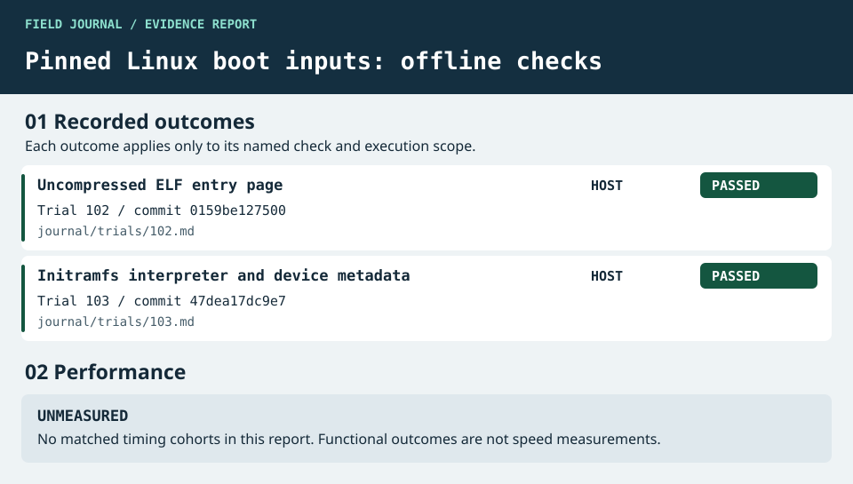

# 103 · Does the pinned initramfs contain the interpreter for `/init`?

**PASS · offline host inspection.** The command line selects `/init`. Its shell, BusyBox's ELF interpreter and both early console device nodes are present with the expected types and permissions. No archive member was executed or written to the filesystem. This rules out a missing interpreter in this image; it does not establish dynamic library resolution, kernel ELF support, a usable serial driver, or a running PID 1.

| Lookup | Observed in the pinned inputs |
|---|---|
| Command line → init | `rdinit=/init`; `/init` is an executable regular file (`100755`, 541 bytes). Its first line is `#!/bin/sh` with LF, not CRLF. |
| Shell → program | `/bin/sh` is a relative symlink to `busybox` in the same directory. `/bin/busybox` is an executable ELF64 little-endian x86-64 file (`100755`, 804,616 bytes). |
| Program → interpreter | BusyBox's `PT_INTERP` at file offset `0x334` is 25 bytes including the terminator. It names `/lib/ld-musl-x86_64.so.1`, an executable regular ELF64 little-endian x86-64 file (670,312 bytes). |
| Device nodes | `/dev/console`: character, `0600`, major/minor `5:1`. `/dev/null`: character, `0666`, `1:3`. Metadata is not evidence of device service. |

## Reproduce

Use the [feature revision](https://github.com/kuro1337WStuff/hv/tree/47dea17dc9e77faf97fc38f0344dfb65880a5738), not the firmware snapshot on `main`. Supply the retained inputs at the paths below. The CLI verifies their size and SHA-256 before parsing and needs only the Python standard library.

```sh
python -m unittest -v lab.tests.verify_initramfs_test
python -S lab/linux/verify_initramfs.py build/session-048-inputs/initramfs.cpio build/session-048-inputs/cmdline.bin
```

| Input | Bytes | SHA-256 |
|---|---:|---|
| `initramfs.cpio` | 1,476,964 | `99db7e0bb0742619d85deaab031ff7a539cd8e46cb6b7dd8ed8dd01196e3baa4` |
| `cmdline.bin` | 123 | `5161eac9cd95353e2d47917e60e46bef0630b64f4bc2645f4cffd2b17f1bf958` |

The verifier counted 11 `newc` members before the final `TRAILER!!!`. Eight tests passed, covering exact pins, framing and duplicate names, command-line selection, script and link errors, ELF range and interpreter errors, and device metadata. As an independent cross-check, `bsdtar` listed the archive and streamed the selected files to memory; a separate ELF-header read found the same interpreter. Neither check used a VM.

[Reservation](https://github.com/kuro1337WStuff/hv/issues/13#issuecomment-7178172338) · [work item #91](https://github.com/kuro1337WStuff/hv/issues/91) · [implementation #100](https://github.com/kuro1337WStuff/hv/pull/100) · [related kernel-page trial 102](102.md)



[Figure source records](../reports/boot-inputs-103.json) · [report generator and measurement rules](../../lab/measurement/README.md). These are correctness records, not a benchmark.
