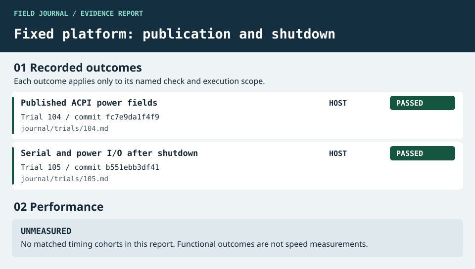

# 105 · Can serial or power I/O change a stopped virtual machine?

**PASS · host device model only.** One fixed scalar I/O entry point routed the four legacy COM windows and the PM1a event and control registers to their existing device owners. The first valid S5 request returned shutdown. Later accesses were refused before dispatch, with the entire modeled device state and caller's operand unchanged. No host ports were touched.

| Phase | Observed |
|---|---|
| Serial | COM1 retained `A`. Writes to COM2–4 did not enter its capture; reads from those absent windows returned `0xff`. |
| ACPI events | Clearing `WAK_STS` in the high status byte left `0x0020`; enable readback was also `0x0020`. Neither operation selected shutdown or disturbed the captured byte. |
| Select then stop | Control read `0x0001`; writing `0x1401` left the model running and read back `0x1401`. COM1 then accepted `B`. A word OUT of `0x3401` to `0x604` stopped the model with capture `AB` and the event registers still `0x0020`. |
| Refusals | Before stop: wrong widths, non-scalar forms, illegal register directions and an unknown port refused. After stop: a side-effecting serial read, TX and scratch writes, absent-port reads, event reads/writes, a control read, duplicate shutdown and an unknown port refused. No state or operand changed. |

**Reproduce:** from [feature revision `b551ebb3`](https://github.com/kuro1337WStuff/hv/tree/b551ebb3df41969b5a2856eed5edc736661d2fb1), build and run each of `lab\tests\com_pm1_scalar_io_test.c`, `legacy_com_test.c`, `power_event_test.c` and `power_request_test.c` (all under `lab\tests`) with `cl /nologo /O2 /std:c11 /TC /W4 /WX` in an x64 VS Developer Command Prompt. All four programs passed on merge tree `e8e09a120944532e10ffee41d26c8e86417583ad`, which includes [104](104.md). The router is opt-in host code, not wired to VM exits. No guest, real power-off, VM state change or timing measurement.

[Reservation](https://github.com/kuro1337WStuff/hv/issues/13#issuecomment-7178323846) · [work item #102](https://github.com/kuro1337WStuff/hv/issues/102) · [implementation #105](https://github.com/kuro1337WStuff/hv/pull/105)

[Figure source records](../reports/fixed-platform-105.json) · [report generator](../../lab/measurement/README.md)
