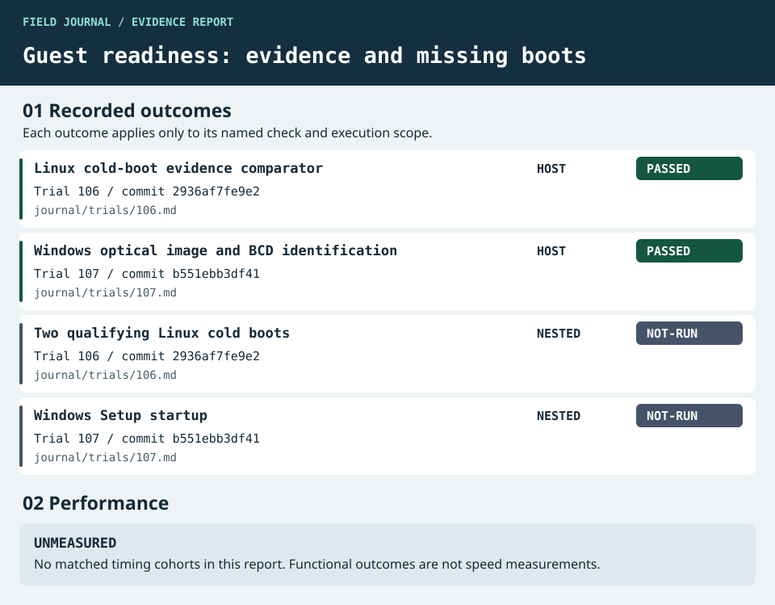

# 107 · Where does an x64 optical WinPE boot first stop?

**Design review only. The first unmet gate is guest-side boot selection:** L2 has no evidenced firmware consumer that can discover a read-only optical medium, select its EFI boot image and start its removable-media EFI application. L0 starting the L1 EFI application does not perform any of those operations for L2. No Windows or fixture boot is reported here.

[Reservation](https://github.com/kuro1337WStuff/hv/issues/13#issuecomment-7178474150) · [work item #108](https://github.com/kuro1337WStuff/hv/issues/108)

### What already runs

At the reviewed revision, [L1 handoff](https://github.com/kuro1337WStuff/hv/blob/b551ebb3df41969b5a2856eed5edc736661d2fb1/firmware/l1_handoff.c#L439-L472) obtains the **outer** memory map and exits outer boot services. Its direct framebuffer is an L1 reporting surface. [Private NPT fixture](https://github.com/kuro1337WStuff/hv/blob/b551ebb3df41969b5a2856eed5edc736661d2fb1/firmware/pkg_private.h) checks specific allowed leaves and a fault at the next page; the [Linux entry guard](https://github.com/kuro1337WStuff/hv/blob/b551ebb3df41969b5a2856eed5edc736661d2fb1/firmware/linux_entry_guard.h) checks a different, prescribed register, paging and boot-parameter contract. Neither constructs an EFI system table for Windows.

[Published 041 ledger](../test-report.md#041--2026-11-25--standalone-runtime-package-and-two-processor-control): the fixed package passed by framebuffer review, not queue completion. Legacy register/FP preservation, a refused CPUID, delivered guest exception, private-page boundary and separate UART/timer witnesses are useful controls, not a general vCPU/platform qualification. The [105 serial/power model](105.md) explicitly is not wired to VM exits.

### Required chain (dependencies, not a claimed trace)

1. **Disc → EFI volume.** For a selected optical device, locate the El Torito boot record and referenced boot catalog, validate the catalog and select a bootable EFI-platform (`0xEF`) no-emulation entry. Its image extent is an EFI FAT volume, not x86 BIOS code to jump to. Resolve the x64 removable-media default `\EFI\BOOT\BOOTX64.EFI` in that volume. Do not assume the first catalog entry is EFI, or equate the FAT image with the surrounding installation filesystem. See [UEFI media access, including El Torito](https://uefi.org/specs/UEFI/2.10/13_Protocols_Media_Access.html), [UEFI boot manager](https://uefi.org/specs/UEFI/2.10/03_Boot_Manager.html) and [Microsoft optical mastering example](https://learn.microsoft.com/en-us/windows-hardware/manufacture/desktop/oscdimg-command-line-options?view=windows-11).
2. **EFI application → Windows Boot Manager.** Load an AMD64 EFI PE32+ application as an image (sections, zero-fill, supported relocations and executable entry), not a flat blob. Invoke its x64 EFI entry with image handle in RCX, guest system-table pointer in RDX and the specified stack alignment/home space. Guest handles, loaded-image/device paths, file/block access and service pointers must refer to guest objects; no outer EFI calls or pointers. The optical entry must reach Windows Boot Manager; do not infer a second filename, prompt or mandatory chainloader solely from the fallback name. [UEFI ABI](https://uefi.org/specs/UEFI/2.10/02_Overview.html) · [PE format](https://learn.microsoft.com/en-us/windows/win32/debug/pe-format).
3. **Boot Manager → BCD-selected WinPE.** Read the media's EFI BCD store and resolve the selected loader object's `device`, `osdevice`, loader path and ramdisk options. Conventional Setup media use `\sources\boot.wim` and SDI backing described by `ramdisksdidevice`/`ramdisksdipath` (often `\boot\boot.sdi`); the WIM supplies the bootable PE image, not the OS being installed. The EFI Windows loader (`winload.efi`) in that environment loads the PE kernel and boot drivers. Treat these as object dependencies, not an asserted file-read order. Microsoft's [ramdisk BCD example](https://learn.microsoft.com/en-us/windows/deployment/configure-a-pxe-server-to-load-windows-pe) documents these fields; its PXE transport and BIOS example loader are **not** steps in optical EFI boot.
4. **WinPE → Setup.** After loader handoff the kernel needs its own drivers; EFI file/block services do not remain its I/O stack. WinPE initializes its environment and configured startup launches Setup on Setup media. Reaching a PE kernel, showing the Setup UI, finding installation content, and applying the selected install image to a writable target are four different witnesses. The latter is not necessary to show first UI. [WinPE](https://learn.microsoft.com/en-us/windows-hardware/manufacture/desktop/winpe-intro?view=windows-11) · [PE initialization](https://learn.microsoft.com/en-us/windows-hardware/manufacture/desktop/wpeinit-and-startnetcmd-using-winpe-startup-scripts?view=windows-11) · [Setup phases](https://learn.microsoft.com/en-us/windows-hardware/manufacture/desktop/windows-setup-installation-process?view=windows-11).

**Candidate, not qualification.** The modified media identifies x64 en-US Windows PE and Setup `10.0.19041.1288`, and a separate Enterprise LTSC 2021 x64 install image `10.0.19044.3324`. Read-only inspection traced the sector 17 boot record to catalog LBA 1403 (valid signature and checksum). Its EFI section selects a bootable no-emulation image at LBA 1406; the size is 2,880 units of 512 bytes. The FAT image matches `efisys.bin`. Its `EFI/BOOT/BOOTX64.EFI` is a 1,174,024-byte AMD64 EFI application, **not** the identically named 1,557,304-byte file in the outer UDF filesystem.

**Selected BCD objects.** The Windows Offline Registry API read a private copy of the EFI BCD store. Boot Manager's default and sole display-order entry identify the same Windows Setup loader, `\windows\system32\boot\winload.efi`. Its `device` and `osdevice` both reference `\sources\boot.wim` and the same media-specific RAM-disk options object; that object's SDI path is `\boot\boot.sdi`. These bindings establish the configured path, not successful execution or Secure Boot acceptance. An unmodified, licensed Microsoft image is the comparison needed to distinguish stock Windows behavior from changes in this candidate.

### Boundaries a later gate must demonstrate

| Boundary | Required evidence, beyond the fixed runtime |
|---|---|
| Memory and firmware lifetime | L2-only allocations for firmware, tables, stacks, loaded images and ramdisk; guest EFI descriptors consistent with actual guest RAM/reservations and NPT, no L1 frames exposed. A guest `GetMemoryMap` key must track guest map changes; guest `ExitBootServices` must reject a stale key and retire boot-only interfaces on success. Preserve only advertised runtime ranges/services. [UEFI boot services](https://uefi.org/specs/UEFI/2.10/07_Services_Boot_Services.html). |
| Storage ownership | Present a bounded read-only optical source both to firmware and, when needed after handoff, via a discoverable virtual controller with a matching PE driver. Demonstrate reads of installation content after firmware I/O ends. A later install requires a separate writable virtual disk, matched driver, isolated writes and readback; the PE RAM disk is neither optical media nor that target. [Windows storage stack](https://learn.microsoft.com/en-us/windows-hardware/drivers/storage/storage-driver-architecture). |
| Interrupts and time | Match only the interrupt routing, acknowledgments and timers advertised by the guest platform and needed by selected drivers. Show asynchronous completion and timer progress after handoff; one scripted wake does not prove either driver path. Do not prescribe a chipset from an ISO version. |
| Display, input and diagnostics | Supply a guest-visible console/graphics mode and guest-owned framebuffer, then verify PE display continuity and input for interactive Setup. Independent guest serial capture is useful evidence if configured; L1 text, serial bytes or a halted CPU alone do not establish a Setup screen. |
| Stop | Distinguish firmware reset/shutdown requests and an OS power path exposed by the guest platform from a diagnostic HLT. Consume a supported request inside the model, stop only L2, log its cause and reject subsequent I/O. Never relay a request to hardware. |

### Smallest next discriminator: optical selection only

Use two tiny synthetic, non-Windows read-only discs in guest-private memory with identical geometry. On the positive disc a valid EFI catalog entry points to one bounded FAT image containing a uniquely marked x64 fallback file. On the negative change only the entry platform to non-EFI (keep the catalog validation entry valid). Fixed guest-side selector, no PE execution, Windows code, writable disk or general firmware implementation yet. Reject malformed or out-of-range reads before copying. No forwarding, host firmware callback, controller passthrough or physical device access.

Require **both** (a) a guest-private result with the selected extent and fallback-file marker, or explicit no-EFI-entry status, and (b) an independently collected L1 block-request trace checked against the authored sector layout. Positive must read catalog, selected volume and marked file; negative must stop after catalog processing without reading the image extent or producing its marker. In both cases verify medium and adjacent guard bytes unchanged. This separates discovery from image execution: even two expected outcomes would not qualify the PE loader, BCD, kernel or Setup.

[Figure source records](../reports/guest-readiness-107.json) · [report generator](../../lab/measurement/README.md) · [optical selection work item](https://github.com/kuro1337WStuff/hv/issues/110).
