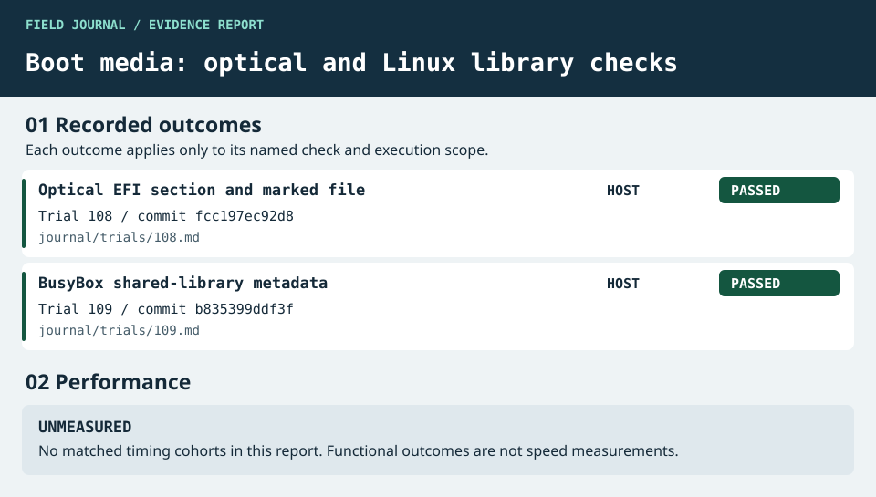

# 109 · Does the pinned initramfs contain BusyBox's declared library?

**Yes, in the archive. Dynamic linking was not run.** [103](103.md) established the path from `/init` to the ELF interpreter. This check reads BusyBox's and the interpreter's own dynamic entries to determine which shared libraries they declare. The path is complete for these pinned files:

| Evidence | Observation |
|---|---|
| `/bin/busybox` | Sole `DT_NEEDED`: `libc.musl-x86_64.so.1`; no `DT_SONAME`. `PT_INTERP` names `/lib/ld-musl-x86_64.so.1`. |
| `/lib/libc.musl-x86_64.so.1` | Relative archive symlink to `ld-musl-x86_64.so.1` in the same directory. No lookup used the host's filesystem. |
| `/lib/ld-musl-x86_64.so.1` | `DT_SONAME` equals `libc.musl-x86_64.so.1`; no `DT_NEEDED` entries. |

The verifier follows `PT_DYNAMIC` and maps the bounded dynamic string table through file-backed `PT_LOAD` ranges. An independent check streamed both files from `bsdtar`, followed each ELF's `SHT_DYNAMIC` section to its linked string table, and obtained the same names. An archive listing independently confirmed the relative symlink. Finding a filename somewhere in an ELF would not establish this relationship.

**Reproduce** at [feature revision `b835399d`](https://github.com/kuro1337WStuff/hv/tree/b835399ddf3fbe2739b0969165677b1f5df98f98), using the two [input pins recorded in 103](103.md#reproduce):

```sh
python -B -m unittest -v lab.tests.verify_initramfs_test
python -B -S lab/linux/verify_initramfs.py build/session-048-inputs/initramfs.cpio build/session-048-inputs/cmdline.bin
```

All **12 tests passed** on tree `02240fbb011f38a44db29c4a469fba5a25117b07`; the CLI separately passed on the 1,476,964-byte archive and 123-byte command line. Fixtures rejected missing or redirected aliases, wrong or extra dependencies, mismatched SONAME, truncated strings and dynamic entries, and ranges backed only by zero-fill or by ambiguous segments. This checks the fixed metadata, not symbol relocation, musl's runtime search behavior, or successful PID 1 execution. No guest boot or host installation.

[Reservation](https://github.com/kuro1337WStuff/hv/issues/13#issuecomment-7178653412) · [work item #111](https://github.com/kuro1337WStuff/hv/issues/111) · [implementation #117](https://github.com/kuro1337WStuff/hv/pull/117)



[Figure source records](../reports/boot-media-109.json) · [System V ABI: dynamic section](https://gabi.xinuos.com/elf/08-dynamic.html)
