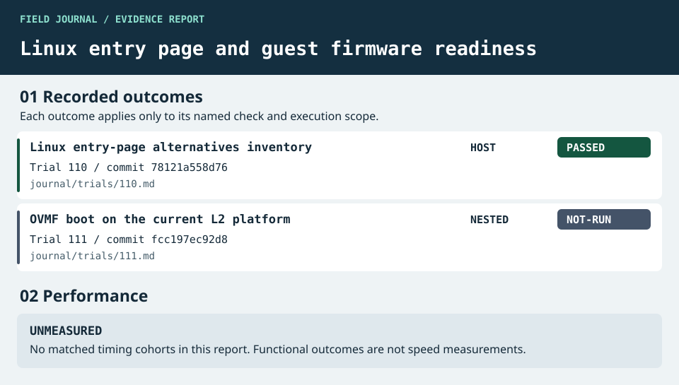

# 111 · Can existing x64 OVMF consume our L2 optical fixture?

**Decision: not on the reviewed platform.** The first mismatch is the first instruction fetch, before OVMF can ask how much RAM exists or look for a disc. Reuse OVMF if a PC-compatible L2 becomes an explicit goal; do not build a second firmware to bridge the gap. Defer Windows now. This is a source review for [#116](https://github.com/kuro1337WStuff/hv/issues/116), [reservation 111](https://github.com/kuro1337WStuff/hv/issues/13#issuecomment-7178816728), not a build, execution trace or PASS.

**Configuration reviewed.** Tianocore `edk2-stable202611` at `556dcfb466e9f05affeaff881d738807f8156d3c`, `OvmfPkgX64`, default 4096-KiB FD; `SECURE_BOOT_ENABLE=FALSE`, `SMM_REQUIRE=FALSE`, `QEMU_PV_VARS=FALSE`, `STANDALONE_MM_ENABLE=FALSE` ([DSC defaults][dsc]). Choose the split CODE/VARS product, a cold, single-BSP, ordinary unencrypted x64 PC, i440FX/PIIX4, `fw_cfg` E820 discovery, one modern PCI virtio-SCSI controller and one read-only CD-ROM LUN. Those are **machine choices**, not promises made by selecting X64 or by running on a Ryzen 9950X. AMD SVM/NPT supplies neither a QEMU machine nor guest UEFI services.

| Boundary | What must be true on this route | What hv `fcc197ec92d8fadee68e71eb2cf07ea4318630f9` actually supplies |
|---|---|---|
| Reset → SEC | Supply the x86 reset fetch at GPA `0xfffffff0`, not a flat-file entry. [FD geometry][geometry] and [FDF placement][fd] put VARS at `0xffc00000`, CODE at `0xffc84000`, SECFV at `0xfffcc000`, ending just below 4 GiB. CODE includes compact main FV and SECFV with reset vector and SEC. [Vector][vector] → [real/flat mode transitions, BFV and SEC lookup][resetmain] → x64 SEC; provide guest-private temporary RAM, stack and scratch so SEC can [decompress the memory FVs, find PEI and call it][sec]. | The [fixed VMCB][vmcb] sets RIP to `FixedGuestGpa`; the [fixed NPT][npt] makes its read-only code leaf at **`0x1000`**. Starting a known instruction there is not resetting into a high ROM window. Other [standalone profiles][standalone] select their own contracts, not successive stages of a PC boot. |
| PEI → DXE | PEI [reads host-bridge DID, initializes the CPU count, publishes PEI memory and RAM regions][pei]. Supply `fw_cfg` file directory/selection/data with `etc/e820` records, including usable RAM and reservations consistent with actual private mappings. [MemDetect][mem] checks record-size divisibility; for low-memory sizing it can instead use CMOS `0x34/0x35` (64-KiB units above 16 MiB). That alternative is **not** a replacement for every use of `fw_cfg`. [Permanent PEI memory][peimem], resource HOBs, DXE IPL and DXE Core must agree about owned RAM, holes and firmware reservations. | [Linux layout][linux] prepares a 128-MiB, one-CPU bzImage handoff and E820 bytes for Linux boot parameters. Those bytes are not `fw_cfg` registers, CMOS, PEI allocation or a HOB list. Outer boot services do not survive as L2 boot services ([handoff boundary][standalone]). |
| Chipset → PCI | The [DSC PCI library binding][pci] uses CF8/CFC config access. DID `0x1237` selects the [82441 and PIIX4 PM function at `00:01.3`][piix]; [platform initialization][chipset] checks/enables PM base, PCI I/O decode and PM I/O enable. Provide working PM timer/time and the CPU/interrupt facilities used by the selected DXE path, not just matching IDs. DXE includes local APIC timer, PCI host bridge and PCI bus drivers; the [root bridge library][root] supplies I/O and MMIO apertures. Config reads for absent functions, resource sizing, BAR allocation/decode and controller accesses must agree. | The [scalar COM/PM1 router][ports] owns particular ports; it neither forwards I/O nor resumes a vCPU. The [fixed interrupt fixture][irq] acknowledges its chosen vector with a VMMCALL. Neither implements PCI config, a PIIX PM timer, general APIC semantics or an enumerated storage controller. |
| Controller → file | [DXE driver inventory][dxe] is not a device. A modern virtio PCI transport must expose the discoverable device and usable config/notify/queue resources. [VirtioScsi][scsi] negotiates features, selects a request queue, needs at least four descriptors, maps a ring and exports extended SCSI pass-through. ScsiBus enumerates a target/LUN; [ScsiDisk][cd] identifies CD-ROM, initializes 2048-byte read-only media and publishes block I/O. Implement inquiry, media detection/capacity and bounded reads with completion/status; reject writes at the backing boundary, not only in a firmware flag. Descriptor, data and status buffers must be checked against guest-owned RAM; no host block path. Disk I/O → [PartitionDxe El Torito][elt] reads descriptor/catalog, checks signature/checksum and publishes a boot-image child. FAT provides Simple File System; the [boot manager][bm] can resolve the removable default `\EFI\BOOT\BOOTX64.EFI`, then LoadImage/StartImage in guest firmware. The partition scanner iterates bootable records; do not equate it to our fixed catalog grammar. | [Our selector][selector] accepts at most 64 optical blocks and a deliberately tiny FAT12 profile. It returns a bounded copy (≤64 bytes) and extent from a read callback. That interface is not a transport, DXE protocol, mounted general filesystem, PE loader or evidence that a fallback application ran. |
| Variable services | Choose immutable CODE plus a separate **guest-private**, initialized VARS flash instance, not writable optical media. The [non-SMM DXE stack][vars] includes flash FVB, emulated-variable FVB, fault-tolerant write and variable runtime drivers. [QEMU flash code][flash] probes writable flash versus RAM/ROM/write protection, and programs/erases through commands. A writable byte array is not that flash model. Boot variables and boot policy belong to L2. A disposable copy per cold trial suffices for this design; persistence across resets needs a separate witness. Emulated variables are another policy, not proof that the selected pflash path works. | Neither a read-only disc callback nor a writable Linux guest RAM range is a private flash device with those semantics. Never borrow L0/L1 EFI handles, services, variables, flash bytes or device addresses. |

**Not requirements merely because they were compiled.** The DSC/FDF also name network, shell, NVMe, ATA, virtio block, UDF and confidential-computing code. None is the controller or filesystem chosen above. A cold non-SMM, non-Secure-Boot selection establishes nothing about S3, key enrollment, TPM, authenticated boot, SMM isolation or production suitability. An EFI optical read does not establish Windows' own post-firmware storage driver, WinPE/Setup, display, installation target or a working OS.

In particular, OVMF's virtio-SCSI driver is **not** a Windows driver. This review did not establish that the selected WinPE image contains a boot-capable driver for that controller. Even a successful EFI optical read would leave that question open.

**Recommendation and stop rule.** An OVMF-compatible L2 reuses upstream PE/COFF loading, boot services and runtime code, but commits us to the machine interfaces above. A narrow fixture is cheaper when the question is *which bytes were selected*; the existing selector already answers that for its format. Extending it with EFI handles, loaders and variables creates a second firmware without testing OVMF. Deferral costs no platform surface and leaves the pinned-Linux-first and separate bench holds intact.

If an owner needs a concrete OVMF discriminator, start with **one offline split-flash address-decoder test**, not a VM. Author inert private CODE/VARS buffers of the stated sizes. The independent fixture author places 16 distinctive bytes at CODE offset `0x37bff0` (last 16 bytes), with distinct neighboring bytes and VARS sentinel; the oracle is that fixed layout, not the decoder's translation. Ask the proposed decoder for 16 bytes at `0xfffffff0`: require exactly the authored bytes from CODE. Negative: same request and bytes, remove only the final CODE page from the declared backing. Require refusal before copy, unchanged output sentinel, no alternate backing lookup. A separately recorded backing-ID/offset/length trace must show exactly the final CODE slice on positive and **no backing read** on refusal; compare both buffers and guards before/after. Use wide range arithmetic at the 4-GiB endpoint. No opcodes, FDs, VM exits or firmware execution needed. Stop there: this would establish only address ownership and refusal, not CPU reset state, flash command behavior, SEC or boot. **Do not build even this test** if no split-flash mapping consumer is planned or if it would displace Linux input/admission work or bench evidence; a test of unused arithmetic does not improve Windows readiness.

[Figure source records](../reports/entry-readiness-111.json) · [associated Linux trial](110.md)

[dsc]: https://github.com/tianocore/edk2/blob/556dcfb466e9f05affeaff881d738807f8156d3c/OvmfPkg/OvmfPkgX64.dsc#L18-L90
[geometry]: https://github.com/tianocore/edk2/blob/556dcfb466e9f05affeaff881d738807f8156d3c/OvmfPkg/Include/Fdf/OvmfPkgDefines.fdf.inc#L53-L67
[fd]: https://github.com/tianocore/edk2/blob/556dcfb466e9f05affeaff881d738807f8156d3c/OvmfPkg/OvmfPkgX64.fdf#L20-L94
[vector]: https://github.com/tianocore/edk2/blob/556dcfb466e9f05affeaff881d738807f8156d3c/OvmfPkg/ResetVector/Ia16/ResetVectorVtf0.nasm.inc#L191-L217
[resetmain]: https://github.com/tianocore/edk2/blob/556dcfb466e9f05affeaff881d738807f8156d3c/OvmfPkg/ResetVector/Main.nasm.inc#L35-L134
[sec]: https://github.com/tianocore/edk2/blob/556dcfb466e9f05affeaff881d738807f8156d3c/OvmfPkg/Sec/SecMain.c#L570-L603
[pei]: https://github.com/tianocore/edk2/blob/556dcfb466e9f05affeaff881d738807f8156d3c/OvmfPkg/PlatformPei/Platform.c#L303-L410
[mem]: https://github.com/tianocore/edk2/blob/556dcfb466e9f05affeaff881d738807f8156d3c/OvmfPkg/Library/PlatformInitLib/MemDetect.c#L382-L495
[peimem]: https://github.com/tianocore/edk2/blob/556dcfb466e9f05affeaff881d738807f8156d3c/OvmfPkg/PlatformPei/MemDetect.c#L285-L394
[pci]: https://github.com/tianocore/edk2/blob/556dcfb466e9f05affeaff881d738807f8156d3c/OvmfPkg/OvmfPkgX64.dsc#L177-L189
[piix]: https://github.com/tianocore/edk2/blob/556dcfb466e9f05affeaff881d738807f8156d3c/OvmfPkg/Include/IndustryStandard/I440FxPiix4.h#L21-L39
[chipset]: https://github.com/tianocore/edk2/blob/556dcfb466e9f05affeaff881d738807f8156d3c/OvmfPkg/Library/PlatformInitLib/Platform.c#L346-L404
[root]: https://github.com/tianocore/edk2/blob/556dcfb466e9f05affeaff881d738807f8156d3c/OvmfPkg/Library/PciHostBridgeLib/PciHostBridgeLib.c#L32-L82
[dxe]: https://github.com/tianocore/edk2/blob/556dcfb466e9f05affeaff881d738807f8156d3c/OvmfPkg/OvmfPkgX64.fdf#L188-L271
[scsi]: https://github.com/tianocore/edk2/blob/556dcfb466e9f05affeaff881d738807f8156d3c/OvmfPkg/VirtioScsiDxe/VirtioScsi.c#L976-L1161
[cd]: https://github.com/tianocore/edk2/blob/556dcfb466e9f05affeaff881d738807f8156d3c/MdeModulePkg/Bus/Scsi/ScsiDiskDxe/ScsiDisk.c#L346-L434
[elt]: https://github.com/tianocore/edk2/blob/556dcfb466e9f05affeaff881d738807f8156d3c/MdeModulePkg/Universal/Disk/PartitionDxe/ElTorito.c#L120-L269
[bm]: https://github.com/tianocore/edk2/blob/556dcfb466e9f05affeaff881d738807f8156d3c/MdeModulePkg/Library/UefiBootManagerLib/BmBoot.c
[vars]: https://github.com/tianocore/edk2/blob/556dcfb466e9f05affeaff881d738807f8156d3c/OvmfPkg/OvmfPkgX64.fdf#L351-L369
[flash]: https://github.com/tianocore/edk2/blob/556dcfb466e9f05affeaff881d738807f8156d3c/OvmfPkg/QemuFlashFvbServicesRuntimeDxe/QemuFlash.c#L51-L136
[npt]: https://github.com/kuro1337WStuff/hv/blob/fcc197ec92d8fadee68e71eb2cf07ea4318630f9/firmware/fixed_npt.h#L6-L18
[vmcb]: https://github.com/kuro1337WStuff/hv/blob/fcc197ec92d8fadee68e71eb2cf07ea4318630f9/firmware/fixed_vmcb.h#L24-L53
[linux]: https://github.com/kuro1337WStuff/hv/blob/fcc197ec92d8fadee68e71eb2cf07ea4318630f9/firmware/linux_layout.h#L10-L18
[standalone]: https://github.com/kuro1337WStuff/hv/blob/fcc197ec92d8fadee68e71eb2cf07ea4318630f9/firmware/standalone_l2.h#L71-L77
[irq]: https://github.com/kuro1337WStuff/hv/blob/fcc197ec92d8fadee68e71eb2cf07ea4318630f9/firmware/pkg_devices.h#L76-L81
[ports]: https://github.com/kuro1337WStuff/hv/blob/fcc197ec92d8fadee68e71eb2cf07ea4318630f9/firmware/com_pm1_scalar_io.h#L14-L32
[selector]: https://github.com/kuro1337WStuff/hv/blob/fcc197ec92d8fadee68e71eb2cf07ea4318630f9/firmware/optical_select.h#L63-L130
