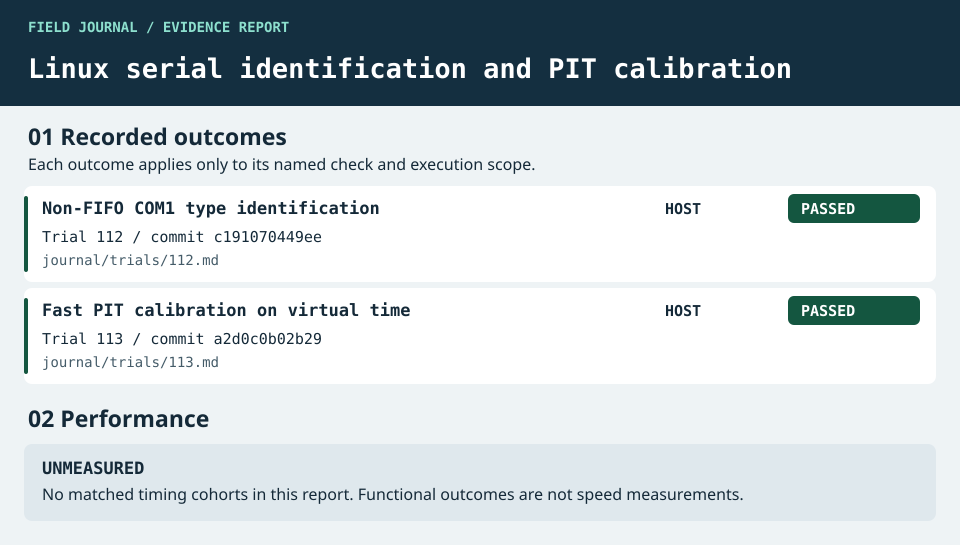

# 113 · Does the fast PIT calibration recover a prescribed virtual clock?

**Yes, on a stable virtual sampling schedule.** The host replay of Linux's `quick_pit_calibrate()` returned **610,909 kHz** for a prescribed **610,909,184 Hz** virtual clock. It accepted iteration 33 after 8,706 low/high read pairs and 8,704 cycle reads. No wall clock, physical PIT or native cycle counter was read. This is a correctness result, not a performance number for either Ryzen processor.

## Independent expectation

The input clock is 1,193,182 PIT pulses per virtual second and 512 virtual cycles per pulse. Channel 2 loads `ffff` on the first pulse. Each successive high-byte transition spans 256 pulses, or 131,072 cycles. The first low/high read straddles the load and is discarded. On the regular one-pulse schedule, the two error terms are each 1,024 cycles. At iteration 32 the sum (2,048) **equals** the allowed threshold and must not pass. At 33 the threshold is 2,112; the observed delta was 4,325,376 cycles. Integer conversion gives `4325376 × 1193182 / (33 × 256 × 1000)`, rounded down to 610,909 kHz. This expectation uses pulse boundaries, not a second copy of the sampling loop.

| Changed input | Observed result |
|---|---|
| Initial band with five / six matching reads | Five: returned zero. Six: continued and recovered 610,909 kHz. |
| Skip the next high-byte band / miss the final verification read | Both returned zero; the latter had the same delta as the successful run. A plausible frequency alone is insufficient. |
| First-iteration error sum exactly 14,912 cycles / one cycle below | Equality rejected immediately. One below continued; the shifted samples produced 610,918 kHz, not the regular-grid result. |
| Freeze clock after load, stop after 14 read pairs | External budget exhausted; Linux's algorithm had not returned. |
| Same frozen clock, sufficient budget | After 50,000 matching reads in one band, the next band had none; returned zero at pair 50,002. |
| All 233 candidate intervals too imprecise | Reached the algorithm's iteration limit and returned zero. |

**Reproduce:** [feature revision `a2d0c0b0`](https://github.com/kuro1337WStuff/hv/tree/a2d0c0b02b2962e513ba03cabd7797719d303056), x64 MSVC developer shell. The ten scenarios passed on tree `8d9d79254866c53a07d5141e3238feed9abc6d02`.

```bat
cl /nologo /O2 /std:c11 /TC /W4 /WX lab\tests\pit_quick_test.c /Fe:pit_quick_test.exe
pit_quick_test.exe
```

[Source: Linux v6.18.60 quick PIT algorithm](https://github.com/gregkh/linux/blob/v6.18.60/arch/x86/kernel/tsc.c#L531-L650) · [097 · separate slower fallback](097.md) · [reservation](https://github.com/kuro1337WStuff/hv/issues/13#issuecomment-7178934875) · [work item #124](https://github.com/kuro1337WStuff/hv/issues/124) · [implementation #130](https://github.com/kuro1337WStuff/hv/pull/130)



[Figure source records](../reports/linux-devices-113.json). No Linux guest selected a clocksource, handled an IRQ, reached PID 1 or booted in this trial.
