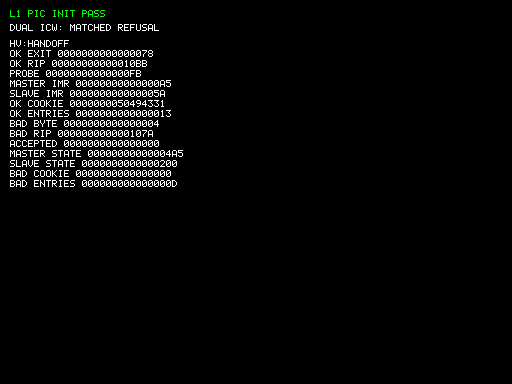

# 138 · Bench A PIC initialization and matched refusal

**2026-11-26 UTC · Ryzen 9 9950X · Hyper-V bench A · standalone AMD SVM L1.** [Reservation](https://github.com/kuro1337WStuff/hv/issues/13#issuecomment-7182287036) · [PIC evidence #14](https://github.com/kuro1337WStuff/hv/issues/14) · [formatter and frozen media, 086](086.md).

Could the corrected display show that a valid dual-PIC initialization completed, and that the invalid byte was refused without accepting it or writing the completion cookie? [068](068.md) remains a failed trial: its original frame was checked against the retained capture, and its failed console was checkpointed with the original pre-run checkpoint still present. No restore or deletion.

The A runner at `56db7a855df590ecefd8474da8b49d17696992af` ran `python lab/hv_queue.py run l1-pic-init` once using the **existing** 086 ISO. No rebuild. ISO SHA-256: `0463d2023e9a9a497bd004d0569036f84b1a112bb6f92f262d7a1bcb31af5a66`. Run `62482c481d0641858ace1279adba6523` booted at 04:08:06 UTC.

| Guest path | Same-run observation (hex) | Verdict |
| --- | --- | --- |
| Valid initialization | HLT exit `78`, RIP `10BB`, probe `FB`, master/slave masks `A5` / `5A`, cookie `50494331`, entries `13` | Completed |
| Invalid initialization | Byte `04` at RIP `107A`; accepted `0`; master/slave states `04A5` / `0200`; cookie `0`; entries `0D` | Matched refusal |

**Guest contract: PASS on inspection. Queue: ATTENTION, exit 3.** The runner had no approved terminal digest for this profile; it saved its last live frame after 60 seconds at 04:09:07 UTC. The captured PNG SHA-256 is `dee2fd868d5e6456697702c20317bea1e0e85e348c9bdac5473eaa9cc44d5e8e`. No digest was installed and the boot was not repeated to turn that stop into a green result.

The one-shot release is spent. A retains the 138 console; B and the reference VM were untouched. No firmware was promoted and [#12](https://github.com/kuro1337WStuff/hv/pull/12) remains draft. This was not a Windows boot: [W01](https://github.com/kuro1337WStuff/hv/issues/203) still needs a separately admitted reset-vector-to-SEC trace from pinned L2 firmware.
