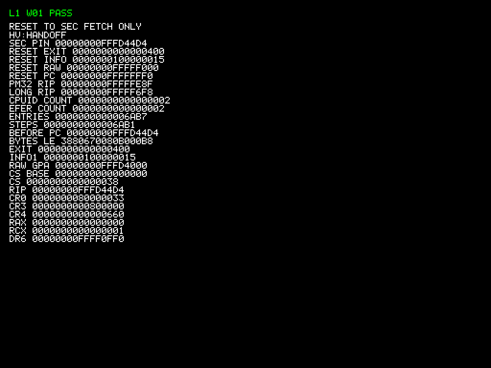

# 139 · Does standalone L1 reach the pinned OVMF SEC entry?

**2026-11-26 UTC · Ryzen 9 9950X · Hyper-V bench A · AMD SVM/NPT.** [Boot gate W01](https://github.com/kuro1337WStuff/hv/issues/206) · [milestone](https://github.com/kuro1337WStuff/hv/issues/203) · [reservation](https://github.com/kuro1337WStuff/hv/issues/13#issuecomment-7198879738). Diagram boundaries: boot chain and address translation.

**Result: W01 PASS on console review; queue `ATTENTION`.** The same cold L2 attempt fetched at `0xfffffff0` and then at the independently pinned OVMF SEC entry `0xfffd44d4`. No SEC instruction executed. Windows did not run.

**What counts:** the guest CPU must fetch at reset GPA `0xfffffff0` and reach the first instruction of the actual SEC core in the same cold L2 run. A page-granular fault is not an instruction address on its own. The saved guest PC, translation and fault type must identify the access. [130](130.md) used synthetic bytes on the host; a Windows desktop directly under Hyper-V is also not W01.

### Independent input witnesses

[Hosted build](https://github.com/kuro1337WStuff/hv/actions/runs/45867767076/job/140074917671) of [EDK II `556dcfb4`](https://github.com/tianocore/edk2/tree/556dcfb466e9f05affeaff881d738807f8156d3c), `OvmfPkgX64`, RELEASE GCC, 4 MiB split flash. The local parser admitted both downloaded flash files against digests printed by the build. An intentionally different CODE digest was refused without changing the prepared pin.

| Input | SHA-256 | Observation before guest entry |
| --- | --- | --- |
| CODE | `0d8702e744ae752ba72454a42613df0bf82c5a8831fd6ee52e3c55fa5ea4cfdf` | Last 16 bytes at reset: `0f20c0a8017405e90cffffffe9f1fe90` |
| VARS | `5d2ac383371b408398accee7ec27c8c09ea5b74a0de0ceea6513388b15be5d1e` | Separate 540,672-byte guest variable image |
| Upstream SEC map | `34d7097ce4b0f80fa61193e7598f881ad2eb75839aabe30d01e16b85264659f0` | SEC core entry `0xfffd44d4`; independent parsing of the executable inside CODE gave the same address |

The [two expected addresses were recorded](https://github.com/kuro1337WStuff/hv/issues/206#issuecomment-7199165007) before moving A. They are not guest observations.

### Bench image and stopping rule

The local x64 MSVC build at [feature revision `9e5755a4`](https://github.com/kuro1337WStuff/hv/commit/9e5755a48d7f33cf100f41f47ef5394d49c09110) produced ISO `4d9209df79ca20b082d4b01d4f1b6fbef5ad4b7d0662c2e6e1a7862e9b7e1885`. An independent read of its El Torito boot entry and FAT members matched the linked EFI (`5fba60074aa8111e444f98245c1fac3f294902c6f4bd610a94549453825ad7f0`) and both guest flash files. [Final pre-boot binding](https://github.com/kuro1337WStuff/hv/issues/13#issuecomment-7199421267) · [draft implementation #207](https://github.com/kuro1337WStuff/hv/pull/207).

The profile keeps the SEC page non-executable. It can witness the first fetch without running the SEC body. It permits only reviewed instruction starts in the pinned reset page; an unexpected exit or a missing step ends the trial. The last known console from [138](138.md) was approved solely as a transition guard for 139. No W01 screen digest was supplied.

### What the guest CPU did

One `l1-w01` boot via the existing A broker, run `fbf4d7aa272243c9a0ae5e4d44fd4d79`. At 17:40:30 UTC the worker matched the prior console and took the pre-139 checkpoint. At 17:40:36 it rechecked the live guard, mounted the frozen ISO and started A. At 17:41:37 it stopped at `ATTENTION` and saved the last live frame. It did not automatically recognize or approve a new screen.

| Observation | Reset vector | SEC entry |
| --- | --- | --- |
| NPT exit / `EXITINFO1` | `0x400` / `0x100000015` | `0x400` / `0x100000015` |
| Raw fault GPA (page only) | `0xfffff000` | `0xfffd4000` |
| Guest instruction address | `0xfffffff0` (reset CS base + RIP, paging off) | `0xfffd44d4` (CS `0x38`, base zero; saved RIP and checked translation) |

The exit flags identify protection faults on **instruction fetch**. Neither raw GPA contains the instruction offset. Between them the monitor recorded protected-mode and long-mode instruction pointers, two CPUID intercepts and two EFER intercepts. The pinned reset code's `jmp rsi` targeted the entry identified in the EDK II map before the run. Final `BEFORE PC` and `RIP` agree with that independent address. This is a fetch at SEC, not a claim that SEC initialized memory.

PNG SHA-256: `2d02fc6ab4164e5a11cfb27f73e9c480b1cc519294e3bb8259841595df243c68`. Private worker event-log SHA-256: `75a02838e43e3c9b2d32d8d107b7c92a7520ab87c7e74526ecbed41617ee2a0f`. Build: `firmware\build.cmd l1-w01` with the pinned split flash above. Five [feature PR host checks](https://github.com/kuro1337WStuff/hv/actions/runs/45869664421) passed; none substitutes for the guest capture.

**Next gate: W02.** Observe PEI using guest-private memory, then a DXE marker emitted by L2 in the same run. A is held at 139: preserve the console and pre-139 checkpoint. A subsequent boot needs a reviewed W02 image and witness, a fresh #13 reservation, and explicit approval for the transition. No replay, B or reference-VM change, storage evidence, Windows boot, or physical qualification. The implementation remains on its feature branch.
