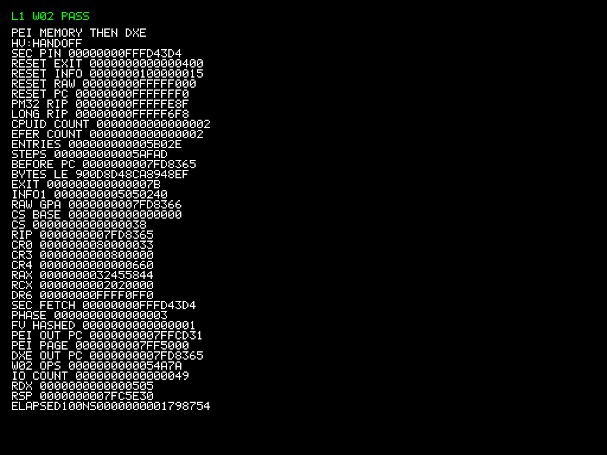

# 140 · Does guest PEI install private memory and reach DXE?

**2026-11-26 UTC · Ryzen 9 9950X · Hyper-V bench A · standalone AMD SVM/NPT L1.** [W02 #209](https://github.com/kuro1337WStuff/hv/issues/209) · [Windows L2 milestone](https://github.com/kuro1337WStuff/hv/issues/203) · [reservation](https://github.com/kuro1337WStuff/hv/issues/13#issuecomment-7199627447). Diagrams: boot chain and backend architecture.

**Result: W02 PASS on console review; queue `ATTENTION`.** In one cold L2 run, relocated PEI Core reported private page `0x07ff5000`. Relocated DXE Core then executed its OUT at `0x07fd8365`. No Windows image was loaded or executed.

**Acceptance:** after cold L2 reset, the guest PEI phase must install permanent memory and use a page backed exclusively by this guest. A distinct marker from executing DXE Core must follow in the same run. A port value without its guest instruction source, a static firmware map, or a frame from [139](139.md) cannot pass W02. DXE IPL is still PEI; neither DXE entry nor W02 alone establishes Windows boot.

### What distinguishes the observations

The [rule was published before bench entry](https://github.com/kuro1337WStuff/hv/issues/209#issuecomment-7199748911). PEI must allocate an aligned page after permanent memory has been installed, write tag `0x32494550` at offset 0 and the complement of the guest address at offset 4092, then report that page to L1 by a scalar output to port `0x505`. The later output (`0x32455844`) must originate in DXE Core. L1 must check the instruction source as well as the port, width, order and private page contents. These constants are expectations, not measurements.

### Preflight finding

The [first guest build](https://github.com/kuro1337WStuff/hv/actions/runs/45871789093) completed, but the PEI map put PEI Core at `0xFFC88000` in flash. SEC copies that volume into private RAM before dispatch, so the image was not eligible. The artifact parser refused it with `PeiCore: unexpected preferred base 0xffc88000`. It was never mounted on A. The [guest build correction](https://github.com/kuro1337WStuff/hv/commit/b0697e895872030ce76dee894a2a1bb6e2fe8b77) sets explicit child-volume RAM bases and makes SEC select the outer firmware volume rather than a page-aligned child.

### Image admitted to bench A

This is a fixed, single-BSP lab board, not stock OVMF or a general-purpose PC. Guest SEC copies the two uncompressed firmware volumes to RAM; the PEI Core, allocator, DXE IPL loader and DXE Core come from EDK II. The board supplies the 32–128 MiB permanent memory range; it supplies no DXE drivers, disk or Windows boot path.

| Input | SHA-256 or location |
| --- | --- |
| [Corrected guest build](https://github.com/kuro1337WStuff/hv/actions/runs/45872486329/job/140091173456), CODE | `e4c41c1b9722502aa3c997f62590ca5b916bca412f3002fb6d83c870662ad1a9` |
| Guest VARS | `5d2ac383371b408398accee7ec27c8c09ea5b74a0de0ceea6513388b15be5d1e` |
| Boot-selected standalone EFI | `bbfb7319ba3577330b26b982c7b26a1ad6cb2a7a877e2a35188e14f003966448` |
| Frozen ISO | `04f82d64a7c7d205fa8259dabf59833bb0d03edfc2955431658e2aa46c4dfda2` |
| Independent guest map and extracted PE images | SEC `0xfffd43d4`; PEI Core XIP base `0x832000`, marker RVA `0x6d31`; DXE Core marker RVA `0x12365` relative to its measured load base |

The guest artifact’s `source.txt` had an empty project-revision field. The authenticated Actions run identifies its head as `b0697e895872030ce76dee894a2a1bb6e2fe8b77`; the build log pins the two flash digests. [L1 revision `60cbdeb3`](https://github.com/kuro1337WStuff/hv/commit/60cbdeb376dd6d7a106ce7348dfb30c08bff1806) also corrects the manifest writer. `firmware\build.cmd l1-w02` produced the EFI and ISO; a separate El Torito/FAT read found the exact linker output and flash pair in the boot-selected ESP. Implementation: [draft #210](https://github.com/kuro1337WStuff/hv/pull/210), stacked on #207.

**Host controls, not guest evidence:** with the authenticated volumes, the verifier accepted both measured sites in order and refused five false observations: early DXE, an incomplete PEI page, wrong PEI site, duplicate PEI, and wrong DXE site. A 65-page REP copy preserved the final page and retired only after its remaining count reached zero.

### Bench A: one cold run

Run `fad19f994a3849798ee96159811715cf`. At 18:08:01 UTC the existing worker matched the [139](139.md) frame and took the pre-140 checkpoint. It rechecked the live console before power-off, mounted the [reserved ISO](https://github.com/kuro1337WStuff/hv/issues/13#issuecomment-7200088632), and booted at 18:08:07. At 18:09:08 it saved the new frame and stopped at `ATTENTION`: no W02 screen digest had been preapproved. That queue result is unchanged.

| Live guest observation | What ties it to the boot |
| --- | --- |
| Reset PC `0xfffffff0` → SEC fetch `0xfffd43d4` | Reset fetch fault `0x400`, raw page `0xfffff000`; SEC PC agrees with the corrected image's map. |
| PEI OUT PC `0x07ffcd31`, page `0x07ff5000` | PC minus measured RVA `0x6d31` gives relocated PEI Core base `0x07ff6000`. The monitor accepted the page only after verifying its private writable/NX backing and both guest-written words. |
| DXE OUT PC `0x07fd8365` | PC minus measured RVA `0x12365` gives relocated DXE Core base `0x07fc6000`. The final exit was SVM IOIO (`0x7b`), `EXITINFO1=0x05050240`, `RDX=0x505`, `RAX=0x32455844`. |
| `FV HASHED=1`, `PHASE=3` | Both copied guest firmware volumes matched the pins. The verifier reached its terminal phase only after the two distinct, ordered module sites. No resume past the DXE OUT. |

The final row labeled `RAW GPA` displays the raw `EXITINFO2` field: for **IOIO**, `0x07fd8366` is the **next instruction pointer**, not a guest physical fault address. No performance benchmark is inferred from this single-step diagnostic.

Screenshot SHA-256: `6ee2efe35d17083e27190e0ae2c7f00d8888153ca0cb87b561a2a2e43286e898`. Original worker event-log SHA-256: `012cc1e07bdab4d03147093a874abc4047eb6bd16a59a808b06f27ea3f98df80`.

**Next gate: W03.** Observe guest UEFI handing control to a pinned Windows Boot Manager and that image executing in L2. Selecting an EFI file, observing DXE, or booting the separate Windows debug VM does not count. Preserve A at 140 and its checkpoint; require reviewed media, an execution witness, a separate reservation and approval for the next transition. B, the reference VM, and the Windows `Start` checkpoint were untouched.
