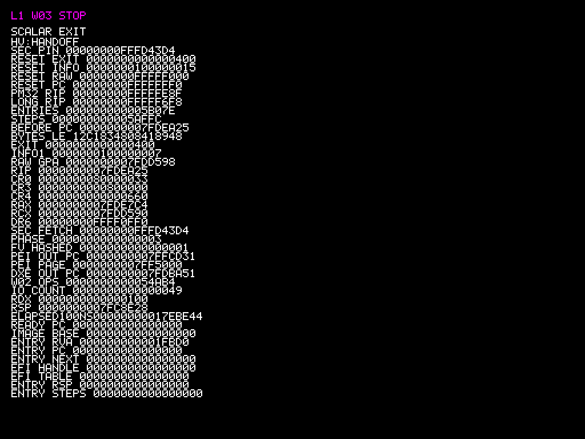

# 141 · Does guest UEFI hand control to Windows Boot Manager?

**Ryzen 9 9950X · Hyper-V bench A · standalone AMD SVM/NPT L1.** [W03 #212](https://github.com/kuro1337WStuff/hv/issues/212) · [reservation](https://github.com/kuro1337WStuff/hv/issues/13#issuecomment-7200752365) · [Windows L2 milestone](https://github.com/kuro1337WStuff/hv/issues/203). Diagrams: boot chain and virtualization levels. Implementation: [draft #213](https://github.com/kuro1337WStuff/hv/pull/213), based on the [W02 feature](https://github.com/kuro1337WStuff/hv/pull/210), not `main`.

**2026-11-26 UTC · W03 NOT PASSED.** One cold run reproduced PEI → DXE, then stopped on a write to the loaded DXE Core's measured `.text`. No successful `LoadImage` marker, `StartImage` handoff or retired Windows instruction was observed. Guest diagnostic `SCALAR EXIT`; queue `ATTENTION`.

### What counts as execution

[140](140.md) stopped inside DXE Core before Windows was loaded. [W03's rule was published before the boot](https://github.com/kuro1337WStuff/hv/issues/212#issuecomment-7200811702): repeat the cold SEC/PEI/DXE chain; have the guest's real UEFI `LoadImage` load the original Windows EFI file, then `StartImage` hand it control. Require a separate CPU observation: the first instruction at the relocated Windows entry retires, RIP advances four bytes, and RSP drops by 40 bytes. File selection, successful `LoadImage`, an attempted fetch, or a frame from the separately installed Windows debug VM is not a pass.

### Which Windows file?

| Identifier | Value |
| --- | --- |
| Source | Operator-supplied Tiny10 23H2 x64; ISO SHA-256 `a11116c0645d892d6a5a7c585ecc1fa13aa66f8c7cc6b03bf1f27bd16860cc35` |
| Selected file | Outer UDF `efi/boot/bootx64.efi` (not the El Torito prompt application); 1,557,304 bytes; SHA-256 `d99ca68bb147f5f30bfb96d9f16b557622ac5a86c2effa2d918badecaa6f88ef` |
| Identity | Version resource: **Boot Manager**, `bootmgr.exe`, `10.0.19041.1`. Host `Get-AuthenticodeSignature` reported `Valid`, signer `Microsoft Windows`. Not a Secure Boot result or authentication of the surrounding Tiny10 distribution. |
| Executable witness | AMD64 PE32+ EFI application, entry RVA `0x1fbd0`, preferred base `0x10000000`. The Windows loader may rebase the image. Compare the initialized `.text` extent (1,425,188 bytes) with the original, accounting for exactly 1,517 DIR64 relocations. |

The firmware uses a fixed guest-private, read-only buffer instead of mounting the Windows ISO or adding a virtual storage controller. Only the nested guest's boot services may load and start the image. This isolates the handoff; it does not test optical discovery, BCD, `winload.efi`, a kernel, Setup, or an installed OS. Windows bytes remain local and are not in Git or the guest firmware build.

### Media and host controls

[Source-only guest build](https://github.com/kuro1337WStuff/hv/actions/runs/45878506982/job/140111578243) at `795100bec188b9795b5a9c5dba6f7651b82a724a` used EDK II `556dcfb466e9f05affeaff881d738807f8156d3c`. CODE SHA-256 `376ce188a220c5529330140550d087ba58123870064de7118dc2251376053588`; VARS `5d2ac383371b408398accee7ec27c8c09ea5b74a0de0ceea6513388b15be5d1e`. Independent measurements from the compiled firmware: SEC entry `0xfffd43d4`, PEI OUT RVA `0x6d31`, DXE OUT RVA `0x12a51`, DXE load-ready OUT RVA `0x14136`.

[`fa7aecee` standalone L1](https://github.com/kuro1337WStuff/hv/commit/fa7aeceeeffdd69fbca2417f5605fe1b95d36252) built with `firmware\build.cmd l1-w03`. Independent readback followed the actual El Torito entry into the selected FAT volume, not the build directory. The EFI matched the linker output (`4b2f472bd21284ad7674122274a9a674d7a0460e4fca8526a7c6e1478b90b99d`); both flash files and the complete Windows file matched the inputs above. Frozen ISO SHA-256: `530a2a23c20c6e3a14681aee7a7d20d60a69c0bb7635ef1fab6441625897ed7e`.

**Host controls, not guest results:** `pefile` independently rebased Windows to `0x04000000`. The native verifier accepted that relocated `.text`, and refused the wrong base, a changed entry byte, and an altered final fixup. The preparer also rejected a one-byte change to the original file.

### What the guest actually did

Run `26db28bc291249d8804c897d958f048f`. At 18:51:09 UTC the existing A broker matched the 140 console and checkpointed it. It rechecked the live frame, mounted the [reviewed image](https://github.com/kuro1337WStuff/hv/issues/13#issuecomment-7200920832) and booted at 18:51:15. No W03 screen digest had been approved; at 18:52:15 the broker retained `ATTENTION` and saved the terminal screen. This was a real stopped guest, not just a runner timeout.

| Observation | Interpretation |
| --- | --- |
| Reset PC `0xfffffff0`; SEC fetch `0xfffd43d4`; `FV HASHED=1`; PEI OUT `0x07ffcd31`, page `0x07ff5000`; DXE OUT `0x07fdba51`, `PHASE=3` | Same-run cold reset, PEI private memory and executing DXE Core. Subtracting the measured DXE marker RVA `0x12a51` gives load base `0x07fc9000`. |
| `BEFORE PC=RIP=0x07fdea25` (DXE RVA `0x15a25`); SVM exit `0x400`, `EXITINFO1=0x100000007`, fault GPA `0x07fdd598` | The first eight captured instruction bytes match the pinned guest firmware. The instruction was `mov qword ptr [rcx+8], rax`; `RCX=0x07fdd590` independently gives the exact fault address. This was a write-protection fault, not an instruction fetch or a disk request. |
| Fault target RVA `0x14598`; verified DXE `.text` spans RVAs `[0x1000, 0x18000)` | DXE attempted to write inside its own measured, sealed code section. The capture identifies the store and address; it does not establish which upstream object was intended to be mutable. |
| `READY PC=0`, `IMAGE BASE=0`, `ENTRY PC=0`, `ENTRY STEPS=0` | No guest load-ready marker or Windows execution. The nonzero `ENTRY RVA=0x1fbd0` is a **preboot expectation**, not an observed instruction. |

Original PNG SHA-256 `942f4f1f9285c3c3b5abb4724b9e2c813c4665c3dbc644723d43650e60b87a1b`; worker event-log SHA-256 `c7fee8a29949e6bd84825b10fbd3f03516378c06ef581893d008c622252c66f6`.

**Release condition:** keep A at 141 with its pre-141 checkpoint. Identify the DXE object receiving the store at RVA `0x14598` in this build and correct its placement or initialization without making executable pages writable. A fresh trial needs reviewed changed media, a new #13 reservation, and an approved transition from 141. First evidence of progress: the store no longer faults, measured code remains intact, and the guest reaches the real load-ready site. W03 itself still requires hardware retirement at Windows entry. No replay, no W04, no new optical fixture. B, reference/057 and the separate Windows debug VM's `Start` checkpoint were untouched.
