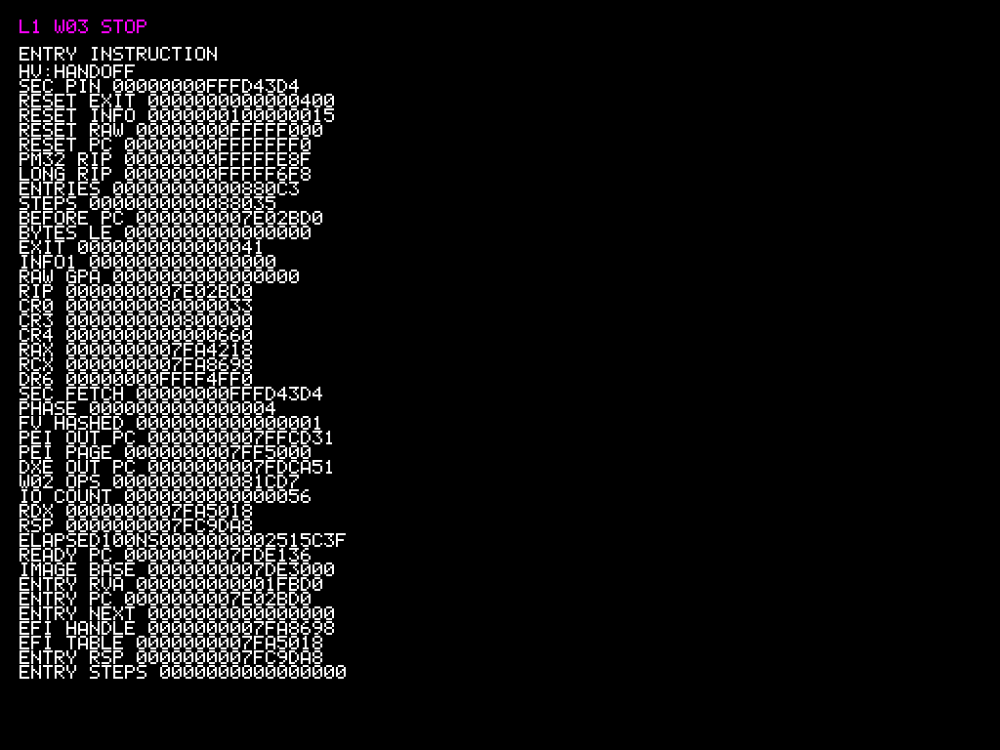

# 142 · Can DXE initialize immutable exception vectors and start Windows Boot Manager?

**Ryzen 9 9950X · bench A · AMD SVM/NPT · W03.** [Reservation](https://github.com/kuro1337WStuff/hv/issues/13#issuecomment-7201027934) · [work item #212](https://github.com/kuro1337WStuff/hv/issues/212) · [implementation #213](https://github.com/kuro1337WStuff/hv/pull/213). Diagrams: boot chain and virtualization levels. No change to the Windows input, guest acceptance rule, or nested page permissions.

### Why 141 stopped

[Trial 141](141.md) stopped in DXE with a write to RVA `0x14598`. In the actual DXE binary, `AsmGetTemplateAddressMap` loaded `RCX` with `AsmIdtVectorBegin` (RVA `0x14590`); at RVA `0x15a25` it wrote `RAX` to `[RCX+8]`. The destination was the eight-byte immediate in the **first executable interrupt-vector stub**, not an IDT data descriptor. The bytes following it contained the same 18-byte layout for successive vectors. The [pinned EDK II source](https://github.com/tianocore/edk2/blob/556dcfb466e9f05affeaff881d738807f8156d3c/UefiCpuPkg/Library/CpuExceptionHandlerLib/X64/ExceptionHandlerAsm.nasm#L471-L494) explains the store: the selected build option filled in the absolute target of each stub at runtime.

[Guest firmware change](https://github.com/kuro1337WStuff/hv/commit/26dd2f4c987dee437afc984f1003ac68b1376bfe): permanent vector stubs use relative jumps to their common handler. The separately copied hook-after template retains an absolute target relocated in non-executable data. The ordinary vector stride remains 18 bytes because [the guest's C implementation uses the same size for the hook template copy](https://github.com/tianocore/edk2/blob/556dcfb466e9f05affeaff881d738807f8156d3c/UefiCpuPkg/Library/CpuExceptionHandlerLib/PeiDxeSmmCpuException.c#L202-L215). No temporary writable code, exception bypass, or change to Windows Boot Manager.

**Boot gate:** preserved code and forward execution beyond the former store establish repair progress. Guest load-ready must come from the measured DXE site, then guest `StartImage` must transfer to the signed Windows image and its entry instruction must retire. Neither corrected layout nor a denied instruction fetch is a W03 pass. No BCD, kernel, performance or physical qualification is inferred.

### Verification before moving bench A

The [authenticated build](https://github.com/kuro1337WStuff/hv/actions/runs/45880190530/job/140117306877) produced CODE SHA-256 `0b7907a8ee35110bfc897ae5d73ab396f757e291a6ba5c11d1a40d7ee73ce8b1` and the unchanged VARS `5d2ac383371b408398accee7ec27c8c09ea5b74a0de0ceea6513388b15be5d1e`. An [independent compiled-image check](https://github.com/kuro1337WStuff/hv/blob/52de5b179bb4e3e1b717db24ec5ccc71623e8647/lab/w03/verify_vectors.py) found 256 correct 18-byte RX slots with the same relative branch destination, an address getter that returns without rewriting them, and one DIR64 in the RW/NX hook template. The checker rejected the original 141 getter and a damaged vector 128 in a private copy of the new image. This proves the layout fix; it is not a guest observation.

`firmware\build.cmd l1-w03` rebuilt the standalone image. Independent El Torito/FAT readback matched the selected EFI (`4e3e222ff7bb48a10c157dc2a394875c7627a53dbda1aca88d5512f5fe264ec5`), both guest flash files, and the same Microsoft-signed Windows EFI (`d99ca68bb147f5f30bfb96d9f16b557622ac5a86c2effa2d918badecaa6f88ef`). [Frozen ISO and transition binding](https://github.com/kuro1337WStuff/hv/issues/13#issuecomment-7201147196): `394080a3717d586e2c24d3937f20ae3a4b41455ba9eedf40edd663df4ef33353`. Public CI uses no Windows media.

### Preserving 141 before the cold boot

The first preservation helper created a standard checkpoint of A’s live 141 STOP but refused to power off: Hyper-V reported the checkpoint as `Saved`, not `Running`. The attended inspection verified that A itself was still `Running`, its live frame matched the recorded STOP, and that the saved checkpoint had the expected parent, creation time and original DVD. It reused that checkpoint rather than creating another. Only then did it turn off A. The pre-141 checkpoint was retained. Neither screen was registered as a PASS.

### Guest result · DXE fault fixed; W03 not passed

On 2026-11-26 at 19:07:09 UTC, the broker cold-booted `l1-w03-repair` once on A (run `30411079a08a5d9db15fad63d8363cca`). It checkpointed before mounting the frozen ISO. At 19:08:10 it retained the last live frame and returned `ATTENTION`: no reviewed screen within 60 seconds. The guest terminal itself read **`L1 W03 STOP / ENTRY INSTRUCTION`**.

| Observation in this boot | What it proves |
| --- | --- |
| `FV HASHED=1`; PEI page `0x07ff5000`; DXE OUT `0x07fdca51`; load-ready OUT `0x07fde136`; `PHASE=4` | DXE passed the former vector write fault with code protection intact. Both observed PCs resolve to the same DXE base `0x07fca000` using the independently measured marker RVAs `0x12a51` and `0x14136`. |
| Windows image base `0x07de3000` + pinned entry RVA `0x1fbd0` = observed `RIP=ENTRY PC=0x07e02bd0`; `RCX=EFI HANDLE`, `RDX=EFI TABLE`, `RSP=ENTRY RSP` | The guest took the checked DXE `StartImage` path and transferred to the measured Windows entry with the expected arguments. The loaded image passed the relocated-text check. This is stronger than selection or load-ready alone. |
| `ENTRY STEPS=0`, `ENTRY NEXT=0`; SVM exit `0x41` with RIP still **at** entry | The single-step exit belongs to the transfer **to** entry. It does not prove retirement **at** entry. No Windows kernel, installed OS, or performance result. |

PNG SHA-256 `383656dbe773115027cda38bee090a78e61dbd0e875ec8e47319abca3d73e55a`; worker events SHA-256 `9a432cdb20577f5b61630a092f399a82a9a879cdddaf7b73a1eb6e7ac2ca5186`. [Hosted vector regression passed](https://github.com/kuro1337WStuff/hv/actions/runs/45880762149); that is independent of the VM outcome.

**Next blocker:** the [entry verifier](https://github.com/kuro1337WStuff/hv/blob/26dd2f4c987dee437afc984f1003ac68b1376bfe/firmware/w03_entry.h#L78-L100) requires `d.rex == 8`. The [decoder](https://github.com/kuro1337WStuff/hv/blob/26dd2f4c987dee437afc984f1003ac68b1376bfe/firmware/w02_decode.h#L19-L30) retains the entire REX prefix, `0x48` for the [pinned entry instruction](https://github.com/kuro1337WStuff/hv/blob/26dd2f4c987dee437afc984f1003ac68b1376bfe/firmware/w03_media.py#L41-L48). The valid stack adjustment therefore cannot pass the current comparison. Correct the exact-prefix comparison and test that near-miss prefixes still fail. A separately reserved boot must show `ENTRY STEPS=1`, next RIP at entry + 4, and RSP reduced by 40. Do not relax image, call origin, ABI or page checks.

**Disposition:** A held at 142; preserve its terminal, pre-142 checkpoint and saved 141 STOP. No replay. B, reference/057 and the Windows debug `Start` checkpoint were untouched. No storage request blocked this transition; #201 remains paused.
