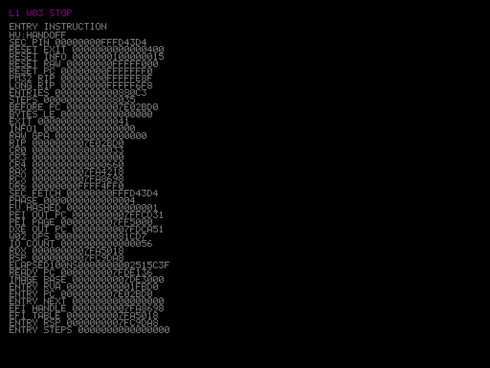

# 143 · Does the first Windows Boot Manager instruction retire in L2?

**Bench A · Ryzen 9 9950X · standalone AMD SVM/NPT nested under Hyper-V · W03.** [Reservation](https://github.com/kuro1337WStuff/hv/issues/13#issuecomment-7201306203) · [gate #212](https://github.com/kuro1337WStuff/hv/issues/212) · [implementation #213](https://github.com/kuro1337WStuff/hv/pull/213). Diagrams: boot chain and virtualization levels.

[142](142.md) reached the signed image’s entry but stopped before executing it. The verifier compared a whole REX prefix to its W-bit mask. [This L1 change](https://github.com/kuro1337WStuff/hv/commit/afbb33ffd757b92f5b718704047e33f8a4b8ba77) checks exactly the four bytes encoding `sub rsp, 40`; it does not admit other instructions or change the guest image. The `StartImage` origin, relocated code, call-frame, page-permission and hardware single-step checks are unchanged.

**Before the boot:** the x64 MSVC host check accepted the independently rebased entry from the local signed EFI and rejected all 1,020 single-byte substitutions. It also rejected a wrong relocation base, changed entry text and altered fixup. No Windows instructions were executed by that host check. `firmware\build.cmd l1-w03` built the standalone boot image. The guest CODE, VARS and signed Windows EFI hashes match [142](142.md).

The [preboot binding](https://github.com/kuro1337WStuff/hv/issues/13#issuecomment-7201383626) identifies the exact 33,607,680-byte ISO (SHA-256 `3f00b6dd19dbbdb44262ede4f9e31c173b463626f4f937081759638ad4fc36c9`). The EFI selected by its El Torito catalog matched the linker output (`2fb5d8612d754cdad5eba326ea44e29fc32aad76271f5e878362061d4cd35db5`). No Windows media is included in the repository.

**Guest acceptance:** after the checked DXE `StartImage` handoff, require a debug single-step exit with RIP exactly four bytes beyond Windows entry, RSP exactly 40 bytes lower, unchanged EFI arguments and `ENTRY STEPS=1`. A transfer to entry with zero steps is not a pass. One cold boot; no kernel, installed desktop, bare-metal or performance claim.

### Disposition · NOT RUN (2026-11-26)

The preservation helper matched the live [142 STOP](../images/w03-142.png) and created one standard checkpoint on A. Its ancestry check then stopped the transition. An attended inspection, without creating or restoring another checkpoint, found A still running on the new `Saved` checkpoint, parented to the pre-142 checkpoint. The saved 141 STOP still existed. The checkpoint lineage and source DVD passed inspection.

| RGB565 evidence (1024 × 768) | SHA-256 |
| --- | --- |
| Recorded 142 STOP and current live A frame | `2614daa691244ecef4334be2a94387772ce1300c6e6c82653776e3575c7bde2f` |
| Hyper-V thumbnail requested from the saved checkpoint settings | `e82fc663841f6c6de9ed16884cda7c6f9fe7c3cc7126921fc760d278f5bae7f5` |

The mismatch does not establish that the checkpoint is corrupt or that the guest state differs. It means the required saved-screen proof was not obtained. Inspection stopped **before power-off**. No protected OFF receipt, staged ISO, submission marker or broker run directory existed. There is no 143 guest screenshot, RIP, RSP or retirement count. **W03 remains open.**

**Release condition:** leave A running at 142 and its checkpoint chain intact. Independently review saved and live captures without restoring or deleting the checkpoint, or obtain an explicit operator decision on an alternative preservation method. Only then authorize a transition and reserve a new run for the frozen, never-booted image. Do not repeat checkpoint creation or count 143 as a guest failure. B, reference/057, Windows debug `Start` and storage fixtures were untouched.

### 2026-11-26 follow-up · same terminal, different palette

A read-only capture from the live VM and the identified saved checkpoint reproduced both RGB565 hashes above. The live capture also decoded to exactly the pixels of the published [142 terminal](../images/w03-142.png). Comparing corresponding pixels in the **original unscaled buffers** gave exactly three pairs:

| Live RGB565 | Saved RGB565 | Pixel positions |
| --- | --- | ---: |
| `0000` | `0000` | 721,456 |
| `F81F` | `780F` | 512 |
| `FFFF` | `7BEF` | 64,464 |

This accounts for every pixel of both 1024 × 768 frames. No glyph shifted, appeared or disappeared; every displayed register and the `ENTRY INSTRUCTION` STOP are identical. The saved preview's darker palette explains the different digests. This resolves the **display evidence** requested in the release condition above; it is not a restore test of saved memory.

Saved preview PNG SHA-256 `127a38a4d3b6d748647c9faa3233f346771980c7f2e698893393ebe37fc44ff3`. The operator authorized capture only. No VM, media, checkpoint, queue or power change; **143 remains NOT RUN**. A new reservation and explicit transition authorization are still needed for the frozen candidate. A future guard can verify the two distinct observed digests separately; it need not accept approximate matches or create a duplicate checkpoint.
