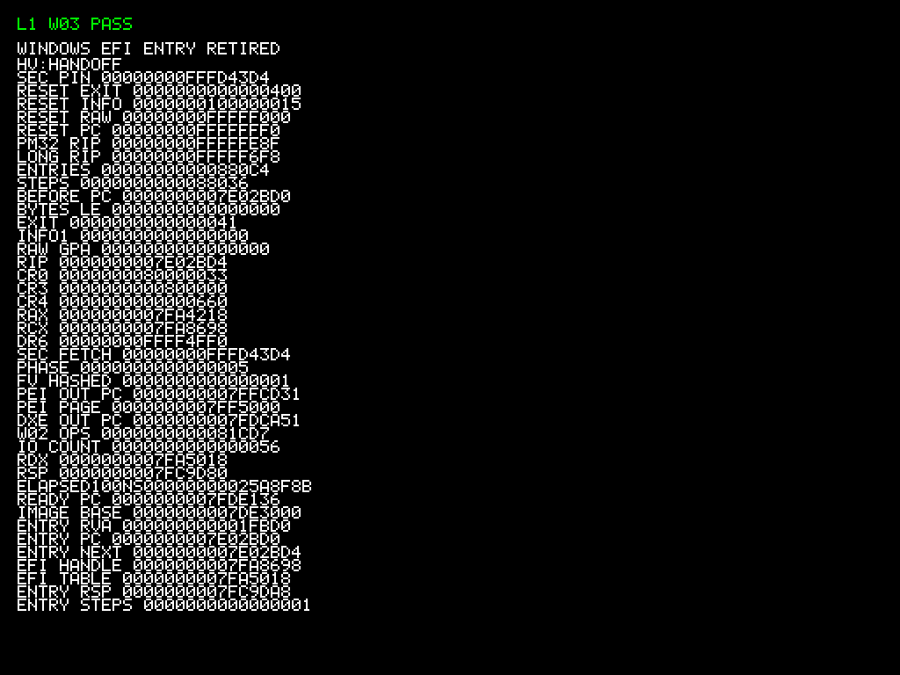

# 144 · Does the frozen W03 image retire a Windows Boot Manager instruction?

**Bench A · Ryzen 9 9950X · standalone AMD SVM/NPT nested under Hyper-V.** [Reservation](https://github.com/kuro1337WStuff/hv/issues/13#issuecomment-7201603845) · [W03 #212](https://github.com/kuro1337WStuff/hv/issues/212) · [implementation #213](https://github.com/kuro1337WStuff/hv/pull/213). Diagrams: boot chain and virtualization levels.

[142](142.md) reached the signed Windows entry but rejected its REX prefix before execution. [143](143.md) corrected the entry check and verified it on the host. Its candidate never booted. Trial 144 reserved one cold boot of those exact bytes; no rebuild or restore.

**Inputs:** [L1 source `afbb33f`](https://github.com/kuro1337WStuff/hv/commit/afbb33ffd757b92f5b718704047e33f8a4b8ba77). Frozen ISO SHA-256 `3f00b6dd19dbbdb44262ede4f9e31c173b463626f4f937081759638ad4fc36c9`; EFI selected by its boot catalog `2fb5d8612d754cdad5eba326ea44e29fc32aad76271f5e878362061d4cd35db5`. The preflight matched the flash CODE, VARS and signed Windows EFI to the [frozen admission](https://github.com/kuro1337WStuff/hv/issues/13#issuecomment-7201383626). No Windows binary is published.

**Acceptance:** in one guest boot, witness DXE `StartImage` transfer to the measured Windows entry, then one hardware single-step exit with next RIP = entry + 4, RSP = entry RSP − 40 and the EFI arguments intact. Neither a fetch at entry nor a host test passes W03. This does not test the Windows kernel, installed user mode, physical hardware or performance.

**Checkpoint transition:** the attended A-only helper verified the live 142 STOP (`2614daa6…`) and its existing saved preview (`e82fc663…`) against their separate [reviewed fingerprints](143.md#2026-11-26-follow-up--same-terminal-different-palette). It verified the checkpoint ID, parent and DVD, rechecked the live STOP before power-off, and retained the same checkpoint afterward. It neither restored the VM nor created a second 142 STOP checkpoint. Trial 143 remains **NOT RUN**.

### Result · W03 PASS on review; queue ATTENTION

On 2026-11-26 at 19:28:42 UTC the broker mounted the frozen ISO and cold-booted A once (run `88103049f38e510ebaa17379a5c669a4`, profile `l1-w03-rex`). It took its normal **powered-off pre-mount checkpoint**, distinct from the existing checkpoint of the live 142 STOP. At 19:29:43 it retained the last live frame and reported `ATTENTION`: neither profile had a preapproved PASS screen. No retry or automatic PASS registration.

| Same-boot observation | Evidence |
| --- | --- |
| Guest firmware handoff | SEC fetch `0xfffd43d4`; PEI private page `0x07ff5000`; DXE OUT `0x07fdca51` and load-ready OUT `0x07fde136`, both resolving to DXE base `0x07fca000` at their measured offsets. |
| Entry belongs to the pinned Windows image | Image base `0x07de3000` + entry RVA `0x1fbd0` = entry PC `0x07e02bd0`. The checked guest `StartImage` path supplied the EFI handle and system table. |
| First instruction retired | `ENTRY STEPS=1`, `PHASE=5`, SVM exit `0x41` (#DB), `DR6=0xffff4ff0` with the single-step bit set. `RIP=ENTRY NEXT=0x07e02bd4` (entry + 4); `RSP=0x07fc9d80` (entry RSP `0x07fc9da8` − 40). `RCX=EFI HANDLE=0x07fa8698`; `RDX=EFI TABLE=0x07fa5018`. |

The archived console PNG matched the protected broker copy byte-for-byte. PNG SHA-256 `73ef6a119ae687278f787ae79360927062ecd032f00a2c6920946c018a2b3be7`; host event-log SHA-256 `19a2a4f002bc374b739e45a72eea06edc9e87441be23fed71911686e4c48e252`. The addresses, stack delta, exit reason and argument registers agree independently of the green banner. Unlike [142](142.md), this exit followed an instruction **inside** Boot Manager, not the transfer **to** it.

**Limit and handoff:** execution deliberately stopped after that one instruction. No Windows loader completion, kernel start, installed desktop or performance measurement. A is held at 144; the 142 STOP and pre-144 checkpoint remain available. Next gate is **W04**: in one separately admitted boot, correlate the verified loader path with a build-identified event emitted by the L2 Windows kernel. No W04 run is queued. B, reference/057 and Windows debug `Start` were untouched. No guest storage blocker was observed.
