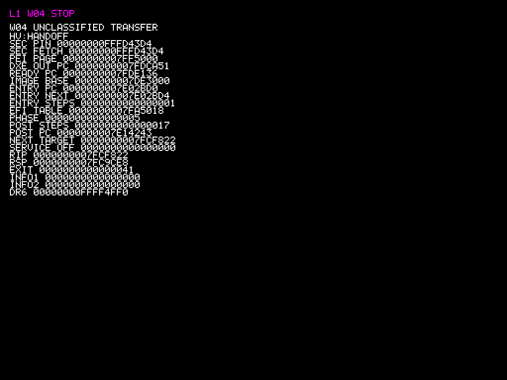

# 146 · First transition after Windows Boot Manager entry

**Bench A · Ryzen 9 9950X · Hyper-V hosting standalone AMD SVM/NPT L1.** [Reservation](https://github.com/kuro1337WStuff/hv/issues/13#issuecomment-7201977253) · [W04 #219](https://github.com/kuro1337WStuff/hv/issues/219) · [implementation #220](https://github.com/kuro1337WStuff/hv/pull/220). Diagrams: VM-exit dispatch and system overview.

**Input:** the frozen [145 image](145.md), not a rebuild. L1 source [`4123adb`](https://github.com/kuro1337WStuff/hv/commit/4123adb2d8c4b64d91c749fa990fe27c7126a91a); profile `l1-w04-loader`; ISO SHA-256 `d4ae62551bed9d40024fb8572183d88fcc6cc67db3b37a11c7509c4c18710e98`. Its L1 EFI changed from [144](144.md); the guest firmware CODE, VARS and signed Windows EFI did not.

**Observation required:** reproduce the W03 entry step and locate the first unsupported post-entry transition or verified call through the guest EFI Boot Services table. Report the actual stop and retired count. No synthetic service result, guest-visible boot volume or preapproved PASS screen. W04 itself requires a build-identified event from the Windows kernel in this same L2 boot; Boot Manager is not the kernel.

**Release:** A’s prior live and saved 144 frames matched their distinct pins. The helper recorded the 16 sorted checkpoint IDs, rechecked them before power-off and verified the same 16 afterward, including saved 142, pre-144 Off and saved 144. Protected OFF receipt SHA-256 `7158fa333650a7fc9fd769eb190463b43744a455272e4bb1fb7616f70b822a50`. No restore, deletion or second 144 preservation checkpoint.

### Result · Boot Manager reached DXE again; W04 did not pass

On 2026-11-26 at 19:50:41 UTC the A broker cold-booted the admitted ISO once, run `3a77382b28295313ba55d492d971ed8f`, after its standard powered-off pre-mount checkpoint. At 19:51:42 it retained the live frame as `ATTENTION`: no terminal for this profile had been preapproved. The L1 diagnostic stopped at `W04 UNCLASSIFIED TRANSFER`; there was no retry.

| Same-boot evidence | Observation |
| --- | --- |
| Signed Windows entry | Image base `0x07de3000`; `ENTRY PC=0x07e02bd0`, `ENTRY NEXT=0x07e02bd4`, `ENTRY STEPS=1`, phase 5. |
| New progress beyond W03 | `POST STEPS=0x17` (**23** instructions after entry). Last Windows PC `0x07e14243`, RVA `0x31243` in its measured text. |
| First external destination | `NEXT TARGET=RIP=0x07fcf822`; SVM exit `0x41` (#DB), `DR6=0xffff4ff0` (single-step). `SERVICE OFF=0`: no verified service slot. The destination instruction was not executed. |
| Independent target placement | DXE OUT `0x07fdca51` − pinned RVA `0x12a51` and READY `0x07fde136` − pinned RVA `0x14136` both give DXE base `0x07fca000`. Target RVA `0x5822` lies in its measured `.text` range `[0x1000, 0x17000)`. This identifies the module, not a function or service. |

The published PNG matched the protected worker copy byte-for-byte, SHA-256 `d2133fe07d6abdc851b07093f27ef73b2bca5f3d53aa3a4e09db322cb09d8185`. Host event log `56f414282a697a6006c1993bdce18d8cfa1d06e6eb4e00b005a775dce36e829c`; protected worker event log `b1d38687ed16e5f1d03a8859eb5672050a598eaa644398d1f54965dcf4866258`. The two logs have different scopes; the queue, manifest and screen match.

**Next W04 observation:** resolve Boot Manager RVA `0x31243` and DXE RVA `0x5822` against these exact inputs. Establish whether the transfer was a call, jump or return and which firmware routine it reached. Only then admit a bounded continuation that proves the expected next guest transition (and return site if it is a call). Do not infer a service from its address. No `winload` handoff, Windows kernel event, installed user mode or storage request was observed. Leave A at this terminal, retain saved 144 and the pre-146 checkpoint, and keep [#219](https://github.com/kuro1337WStuff/hv/issues/219) open. B, reference/057, Windows debug `Start` and optical fixtures were untouched.
